# РетроСПЕКтива — разбор двух кассет для ZX Spectrum: «Балтик»

Оцифровка двух кассет от клона ZX Spectrum «Балтик» и результат их разбора: образы лент,
распакованные файлы, листинги, дизассемблированный код, картинки и описание найденного.

- **`transparent_a`** — 30 лент в TZX (Ramsoft MakeTZX, 2014 год); для лент 01–03, 08,
  08_2, 10, 12 и 19–22 есть и исходные WAV.
- **`green_svema`** — 103 записи WAV на двух сторонах, TZX нет.

Описание получено чтением кода и со слов владельца машины. На настоящем железе ничего не
запускалось; в эмуляторе запускались только «Три недели в раю».

## Оглавление

- [Машина](#машина)
  - [Железо](#железо)
  - [ПЗУ «Балтика»](#пзу-балтика)
- [Кассета `transparent_a`](#кассета-transparent_a)
  - [«Бременские музыканты» — заготовка игры (ленты 08–13)](#бременские-музыканты--заготовка-игры-ленты-0813)
  - [«Три недели в раю» — русификация (ленты 19–21)](#три-недели-в-раю--русификация-ленты-1921)
  - [«Save Game Situation» (ленты 14–18)](#save-game-situation-ленты-1418)
  - [Порт ORDOS (ленты 01–03)](#порт-ordos-ленты-0103)
  - [Музыкальная карта IMC-1 (ленты 22–24, 27, 28)](#музыкальная-карта-imc-1-ленты-2224-27-28)
  - [`PATCH.EXE` — тон через порты AY (ленты 25, 26)](#patchexe--тон-через-порты-ay-ленты-25-26)
  - [PcOut — передача файлов на PC (ленты 29, 30)](#pcout--передача-файлов-на-pc-ленты-29-30)
  - [Звуковой сэмплер (ленты 04–07)](#звуковой-сэмплер-ленты-0407)
- [Кассета `green_svema`](#кассета-green_svema)
  - [Что на стороне 1](#что-на-стороне-1)
  - [Что на стороне 2](#что-на-стороне-2)
  - [Эмулятор «Радио-86РК»](#эмулятор-радио-86рк)
  - [«Питон» для Спектрума (запись 26)](#питон-для-спектрума-запись-26)
  - [Эмулятор «Орион-128» (запись 50)](#эмулятор-орион-128-запись-50)
  - [E.G.-BASIC](#eg-basic)
  - [Спрайты: `Sprites .1` и `SCREEN!`](#спрайты-sprites-1-и-screen)
  - [Музыкальный редактор и мелодии](#музыкальный-редактор-и-мелодии)
  - [Ранние версии печати и Монитора](#ранние-версии-печати-и-монитора)
  - [`VOICER`](#voicer)
  - [HAINTMON](#haintmon)
  - [Программатор ПЗУ `PROG+`](#программатор-пзу-prog)
  - [`READ-HEAD`](#read-head)
- [Файлы и инструменты](#файлы-и-инструменты)
  - [Что лежит в директориях](#что-лежит-в-директориях)
  - [Декодер `wav2tap.py`](#декодер-wav2tappy)
- [Лицензия](#лицензия)

## Машина

### Железо

| Что | Как видно в коде |
|---|---|
| КР580ВВ55 (8255) | порты 31/63/95/127 — A/B/C/управляющий (подтверждено владельцем) |
| Теневое ОЗУ под ПЗУ | бит 7 порта #7E (126): 0 — ПЗУ, 1 — ОЗУ в #0000–#3FFF |
| Положение экрана | переключается битами 0–1 порта #7E; со слов владельца, вариантов было как минимум два — с адреса #4000 (обычный) и с адреса #0000 |
| Экран с цветом 8×1 | атрибуты идут сразу за точками и имеют ту же раскладку: байт цвета на байт точек. Значение 2 в битах 0–1 — экран с адреса #0000 в теневом ОЗУ (точки #0000–#17FF, атрибуты #1800–#2FFF). Значение 1, судя по `mode8/64`, — тот же режим на обычном месте: точки с #4000, атрибуты #5800–#6FFF поверх системных переменных |
| Память 128K | порт #7FFD, в коде часто `OUT (#FD),A` (A уходит в старший байт адреса). Со слов владельца, ПЗУ от 128K в машине не было, и бит выбора ПЗУ в этом порту ничего не делал; переключение страниц ОЗУ работало, большинство игр для 128K шло без проблем |
| Раскладка страниц | #0000 — страница 0 (она же теневое ОЗУ), #4000 — 5, #8000 — 2, #C000 — **7** |
| AY | стандартные порты #FFFD/#BFFD |
| Мышь | квадратурная, через порт C ВВ55 (#5F) |
| Связь с PC | бит 0 порта B (данные), бит 0 порта C (подтверждение) |
| Музыкальная карта IMC-1 | отдельная плата-эмулятор AY на втором Z80 и таймере КР580ВИ53; получает со Спектрума шину данных и стробы записи портов #FFFD и #BFFD. [Подробнее](#музыкальная-карта-imc-1-ленты-2224-27-28) |

«Обычная» страница в #C000 на этой машине — 7, а не 0, как на оригинальном 128K: нулевая
страница занята теневым ОЗУ. Раскладка записана со слов владельца («скорее всего») и
согласуется с подпрограммами `READ`/`WRITE` в исходниках DOS.

«TURBO-MODE» в текстах — это турбо-загрузка с ленты: программа в ПЗУ копировала ПЗУ в
теневое ОЗУ и меняла константы в процедурах загрузки/сохранения. Игра, не работающая в
этом режиме, — та, что пишет в #0000–#3FFF и портит теневое ОЗУ.

### ПЗУ «Балтика»

Полного дампа ПЗУ этой машины нет. Известно о нём следующее.

**Со слов владельца.**

- По адресу 14446 (#386E) в ПЗУ была процедура, которая копировала ПЗУ в теневое ОЗУ и
  правила константы процедур работы с магнитофоном, ускоряя запись и чтение вдвое.
- Шрифт был утолщённый.
- При включении выводилась обычная надпись `(c) 1982 Sinclair Research Ltd`, без заставки.

**С лент.** В образе `HAINTMON` уцелели 94 байта родного ПЗУ, #3C70–#3CCD
(`green_svema/side_2/svema_b_31/04_HAINTMON__.bin`, смещения #402–#45F): обработчик NMI
и строка `    COMPLETE  OLEG BOIKO     MINSK   1990 `.

| Клавиша в обработчике NMI | Действие |
|---|---|
| C | вернуться в программу (`RETN`) |
| B | выйти в BASIC: стек на `RAMTOP`, переход на #04AA |
| M | `LD A,#FF : JP #0069` — включить теневое ОЗУ и вернуться |

Область #386E–#39FF в этом образе занята нулями — процедуры турбо в нём уже нет. Ленты
19, 20 и одна из записей 21-й записаны на удвоенной скорости, то есть её процедурами.

Ещё один возможный след — запись 28 кассеты `green_svema`: 2048 байт, совпадающие с
адресами #03D4–#0BD3 стандартного ПЗУ 48K. Если они сняты с ПЗУ этой машины, то в этой
области (звук и лента, с обычными константами) оно от стандартного не отличалось.

**Из интернета.** Строка с подписью Бойко поиском не находится. В теме «Балтик» на
zx-pk.ru (просмотрены все 16 страниц) выложены три прошивки. Сами файлы в репозиторий не
включены — они чужие, ссылки на тему ниже. Ни в одной нет подписи Бойко и его обработчика
NMI.

| Вложение в теме | Что это |
|---|---|
| `baltic_turbo.zip` (стр. 2) | «Baltic TURBO», дамп участника Zloy (Минск), 3.06.2010 — другая прошивка с похожей процедурой турбо |
| `BaltikTurboROM256.7z` (стр. 3) | «ПЗУ 256», вариант Turbo: по #386E другой код, в #3C58 кусок шрифта |
| `BaltikCPMROM256.7z` (стр. 3) | «ПЗУ 256», вариант CP/M |

Дамп Zloy — **точно не ПЗУ владельца** (владелец это подтвердил): в нём стандартный
шрифт и заставка «БАЛТИК ТУРБО» вместо надписи Sinclair. Но процедура турбо в нём
устроена так же, как описывает владелец, поэтому он полезен как образец. От стандартного
ПЗУ 48K он отличается 651 байтом:

- с #386E — текст заставки «БАЛТИК ТУРБО», код с #38DD; вызывается из инициализации
  (`JP #38DD` по адресу #1296, на месте вывода копирайта);
- после заставки по клавише T вызывается процедура #39AF: копирует ПЗУ в ОЗУ по адресу
  30000, правит 26 байт по таблице с #3959, включает теневое ОЗУ (`OUT (0),A` со
  значением #80), копирует всё обратно в #0000, сверяет и печатает «ТУРБО»;
- константы задержек в процедурах ленты уменьшены примерно вдвое (#04DF: #A4→#51,
  #04F1: #37→#1B, #0519: #42→#21, #052E: #31→#10);
- NMI по #0066: `PUSH AF : LD A,#FF : OUT (#7E),A : POP AF : RETN`; адрес #0069
  приходится на `OUT (#7E),A`, что объясняет клавишу M у Бойко.

Кроме шрифта и заставки, отличие от ПЗУ владельца ещё в том, что в дампе Zloy область
#3C70–#3CFF пуста (#FF) — обработчика NMI с подписью Бойко там нет. Как эти две прошивки
связаны между собой, неизвестно.

По той же теме порт #7E устроен так: биты 0–1 — номер отображаемого экрана, бит 2 —
адресация экранов для CP/M (после доработки платы), бит 7 — 0 ПЗУ, 1 теневое ОЗУ.

Источники: [тема «Балтик», стр. 2](https://zx-pk.ru/threads/1389-baltik/page2.html),
[стр. 3](https://zx-pk.ru/threads/1389-baltik/page3.html).

## Кассета `transparent_a`

По директории на ленту: `transparent_a_NN/`. Номера лент — в заголовках разделов.

### «Бременские музыканты» — заготовка игры (ленты 08–13)

Заготовка квеста на Laser Basic: меню, инструкция и графика; самой игры нет.
В тексте инструкции игра подписана автором и датирована 2002 годом.

Laser Basic, по словам владельца, достался ему не как отдельный продукт: в 1998–1999 годах
он случайно обнаружил его внутри одной из игр, вытащил оттуда и стал использовать сам.
Им же написан редактор расстановки спрайтов `SCREEN!` на кассете `green_svema`.

Что работает в `Musicans.B`:

- четыре окна — графика, текст, инвентарь, персонажи — и пункты меню спрайтами;
- опрос мыши и клавиатуры;
- пункт «Инструкция»: текст с прокруткой.

Пункты «Игра», «Новая игра», «Загрузка» и «Выгрузка» ведут на строки 1000, 2000, 4000 и
5000, где сразу стоит `STOP`. Графики при этом заготовлено больше, чем кода: 62 спрайта
и два экрана — фигурки персонажей, предметы, дома, мебель, карта.

| Лента | Файл | Состояние | Содержимое |
|---|---|---|---|
| 13 | `Musicans.B` | OK | программа на Laser Basic: меню и инструкция |
| 11 | `MUSICA.SPR` | OK | 62 спрайта (персонажи, предметы, дома, надписи меню), см. PNG |
| 09_2 | `Musicnas$1` | OK | экран 6912 байт, поздняя версия |
| 09 | `Musicnas$1` | ошибка чтения | тот же экран |
| 08, 08_2 | `Musicans$` | OK (из WAV) | экран, ранняя версия; оба чтения совпали |
| 10 | `Musicans$2` | OK (из WAV) | второй экран со спрайтами |
| 12 | `MOUSE.EXE` | OK (из WAV) | драйвер мыши (CODE 38882, 414 байт) |

`Musicans$` (ленты 08 и 08_2) — ранняя версия экрана со спрайтами:

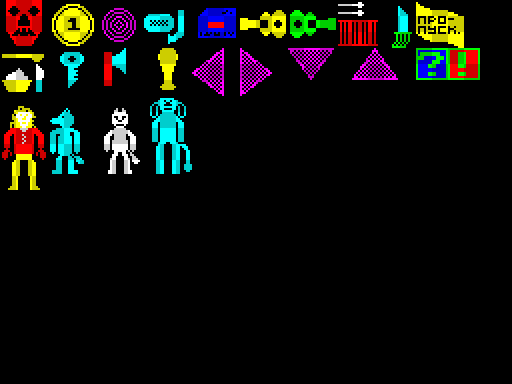

`Musicnas$1` (лента 09_2) — более поздняя версия того же экрана:

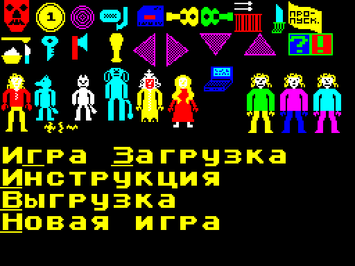

`Musicans$2` (лента 10) — второй экран со спрайтами: дома, мебель:

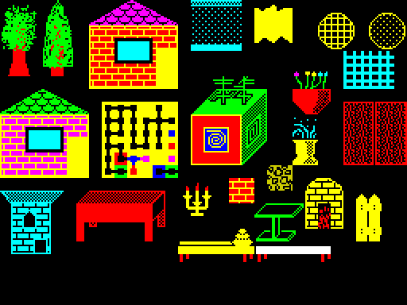

Спрайты из `MUSICA.SPR` (лента 11):

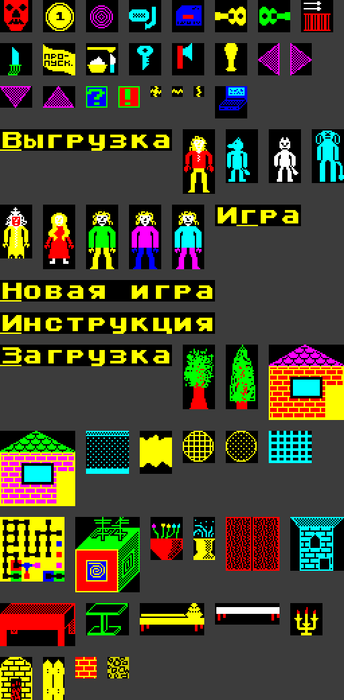

В TZX экраны с лент 08, 08_2 и 10 повреждены (MakeTZX терял синхронизацию), здесь они
прочитаны заново из WAV декодером `wav2tap.py` — целиком, с верной контрольной суммой.
Лента 09 — тот же файл, что на 09_2, с потерей 914 единичных битов
([как прочиталось](transparent_a_09/01_Musicnas$1.png)); WAV для неё нет.

`MOUSE.EXE` читает порт #5F: биты 0–1 и 2–3 — квадратурные сигналы двух осей, биты 4–5 —
кнопки. Рисует курсор 3×5 точек через `PLOT` из ПЗУ (с `OVER 1`), выходит по кнопке или
клавише и оставляет координаты и состояние кнопок в ячейках 39283–39295.

### «Три недели в раю» — русификация (ленты 19–21)

`T.N.R.` — Three Weeks in Paradise (Mikro-Gen, 1986), взломанная и переведённая на
русский. В тексте есть подпись автора перевода с годом — 2002.

| Лента | Файл | Содержимое |
|---|---|---|
| 21 | `T.N.R.EXE` | игра, 38582 байта с адреса 26490 |
| 19 | без заголовка | та же игра, другая редакция: 15 байт текста отличаются |
| 20 | `T.N.R.ZNG` | русский шрифт, 768 байт, грузится на место шрифта ПЗУ (#3D00) |

Тексты в игре набраны латиницей, а шрифт рисует на этих местах кириллицу
(`A`→А, `B`→Б, `&`→Ы, `%`→Ю и т.д.):

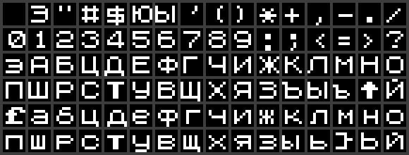

В TZX все три ленты повреждены; прочитаны из WAV. Ленты 19, 20 и одна из двух записей
ленты 21 сделаны на удвоенной скорости (тот самый турбо-режим); вторая запись ленты 21
(`transparent_a_21_22k.wav`) — на обычной, данные в обеих одинаковые. Саму игру я не
дизассемблировал.

#### Как сделан перевод

Разбор по содержимому файла; с оригиналом игры не сравнивалось.

- **Шрифт подменён целиком, код печати не тронут.** Игра рисует текст шрифтом ПЗУ по
  адресу #3C00. Вместо правки игры в теневое ОЗУ на место шрифта ПЗУ грузится `T.N.R.ZNG`,
  где на местах латинских букв нарисованы русские. Поэтому все строки набраны транслитом:
  `KLAVIQI` — «КЛАВИШИ», `V& PROQLI` — «ВЫ ПРОШЛИ», `!TO POHTA` — «ЭТО ПОЧТА»
  (`Q` — Ш, `H` — Ч, `J` — Ж, `X` — Х, `Y` — Я, `&` — Ы, `%` — Ю, `!` — Э).
- **Строки переведены на месте, в исходную длину.** Со слов владельца, он не разбирался,
  как игра находит строки, и вписывал русский текст на место английского, не сдвигая
  соседние надписи. Отсюда сокращения и переносы в названиях предметов: «ПУСТ. РА-» /
  «КУШКА» и «ПОЛН РА-» / «КУШКА» (пустая и полная ракушка), «ТОПОР ТУП» и «ТОПОР ОСТ»
  (тупой и острый), «ВЕДРО» / «ПУСТОЕ» и «ВЕД-» / «РО ПОЛНОЕ», «МОН.»; в реплике
  «ВОЛЛИ,ПОМОГИ.ЭТО Я,УИЛМА» нет пробелов после запятых.
- **Переведено** около шестидесяти строк: подсказка по клавишам, меню («СИНКЛЕР»,
  «КЕМПСТОН», «КЛАВИШИ», «СТАРТ»), сообщения о гибели и победе («ВЫ УМЕРЛИ, И ИЗ-ЗА ВАС У
  ТУЗЕМЦЕВ БУДЕТ УЖИН ИЗ УИЛМЫ И ГЕРБЕРТА», «ВЫ ПРОШЛИ», «ПОЗДРАВЛЯЕМ»), реплики («ТУТ
  ЖИВЕТ КРОКОДИЛ. ПОНЯЛ?», «ГДЕ ПИТ?»), названия всех предметов («БАНКА ШПИНАТА»,
  «КЛЕШНЯ КРАБА», «ЛУК И СТРЕЛЫ», «ТАРЕЛКА КАШИ», «УИЛМИНА СУМКА», «НИЧЕГО») и заставка
  «ТРИ НЕДЕЛИ В РАЮ / МИКРО-ГЕН '86».
- **Подпись** автора перевода («игра взломана и переведена … в 2002 году») вписана в длинную
  строку сразу после «ЭТО ПОЧТА».
- **Не переведено** скрытое послание авторов в конце файла (#F9B3–#FE30, около 1,1 КБ:
  «THREE WEEKS IN PARADISE! GAME, GRAPHICS, CODE AND EVERYTHING ELSE…»). С русским шрифтом
  оно превратилось бы в «ТЧРЕЕ ЩЕЕКС ИН ПАРАДИСЕЭ».

Редакция с ленты 19 — более ранняя. В ней буква Ы набрана другим символом (`\` вместо
`&`), «СТРЕЛА» вместо «СТРЕЛЫ», а в сообщении о гибели туземцев ждал «ЧУДНЫЙ УЖИН» —
в окончательной версии слово убрано.

Про «взломана»: файл — один блок памяти с #677A до #FE30 с точкой входа #F6A6, то есть
игра снята целиком из памяти, а не собрана из блоков оригинального загрузчика. Первые
сорок байт файла — не код, а остатки стека BASIC: трижды повторяются адреса возврата #02DB
и #004D (опрос клавиатуры внутри обработчика прерывания ПЗУ), рядом указатели в область
BASIC. Значит, блок начинается чуть ниже настоящего начала игры и захватывает место, где
у загрузчика лежал стек.

Со слов владельца, игра, скорее всего, снята снэпшотером
[«Save Game Situation»](#save-game-situation-ленты-1418): NMI, сохранение состояния,
сброс, выгрузка на ленту. Это сходится с устройством снэпшотера: копия 48K лежит в
страницах 1, 3 и 4, которые тест памяти ПЗУ при сбросе не затрагивает, и после сброса их
можно по очереди подключить в #C000 уже из BASIC. По самому файлу способ не определить —
остатки стека загрузчика остались бы в памяти в любом случае; как три страницы были
сведены в один блок с #677A, тоже не видно.

Загрузчика, который грузил шрифт в теневое ОЗУ и запускал игру, на лентах нет.

#### Запуск в эмуляторе

Игра берёт шрифт по адресу #3C00, то есть прямо из ПЗУ; на «Балтике» русский шрифт лежал
на этом месте в теневом ОЗУ. Запустить её так же можно в любом эмуляторе, который
позволяет подменить ПЗУ:

```
tnr_48k/build.py --rom 48.rom
```

Скрипт собирает `tnr_48k/T.N.R.tap` (загрузчик на BASIC и игра без единой правки, точка
входа #F6A6), `tnr_48k/T.N.R_plus3.tap` (о нём ниже) и `48-tnr.rom` — ваш образ ПЗУ 48K, в котором шрифт заменён на `T.N.R.ZNG`.
Сам образ ПЗУ в репозиторий не входит. Со стандартным ПЗУ игра тоже работает, но весь
текст выводится транслитом.

Перенести шрифт в ОЗУ, чтобы обойтись одним TAP, не получается — места под него в 48K
нет:

| Область | Чем занята |
|---|---|
| #5B00–#6779 | буфер экрана игры, переписывается целиком |
| #677A–#F9AF | игра |
| #F9B0–#FE0A | ещё один буфер — поверх скрытого послания авторов |
| #FE0B–#FF5D | в прогонах не тронуто (339 байт), но это запас под стек |
| #FF5E–#FFFF | стек (сколько его было занято в прогонах) |

Шрифту нужно 768 байт подряд, а если ограничиться знаками до `Z` — 472 байта. Первая
версия сборки клала шрифт в #6000 и правила адреса в игре: заставка и меню выглядели
правильно, но как только игра начинала рисовать в свой буфер, шрифт затирался, и текст
превращался в мусор.

Проверено в эмуляторе Z80 из SkoolKit с подменённым ПЗУ: загрузка, заставка, меню, игра
и возврат в меню после гибели — текст остаётся целым.

#### Сборка для +2A/+3

У +2A, +2B и +3 есть то же, что и у «Балтика»: режим, в котором на месте ПЗУ стоит ОЗУ
(«special paging», порт #1FFD). `tnr_48k/T.N.R_plus3.tap` этим пользуется, и подменять
ПЗУ в эмуляторе для него не нужно. Загрузчик в машинных кодах (97 байт, #6000, за ним
шрифт) делает следующее:

1. включает ПЗУ 3 (BASIC 48K) и копирует его в страницу 4 ОЗУ;
2. записывает `T.N.R.ZNG` поверх шрифта в этой копии (#3D00);
3. грузит игру стандартной LD-BYTES (#0556) блоком без заголовка — она ложится в
   страницы 5, 2 и 3;
4. копирует страницу 2 в страницу 6;
5. пишет 5 в порт #1FFD — раскладка «всё ОЗУ» 4-5-6-3 — и переходит на #F6A6.

Игра при этом не изменена. Загружать нужно из +3 BASIC или пунктом Loader, не из
48 BASIC: там порты страниц заблокированы. Если загрузка не удалась, бордюр остаётся
красным.

Проверено в эмуляторе Xpeccy+ в режимах +2A и +3: игра загружается и работает, текст
в игре (названия предметов, бегущая строка) русский. На настоящем железе не запускалось.

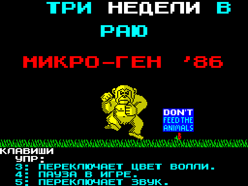
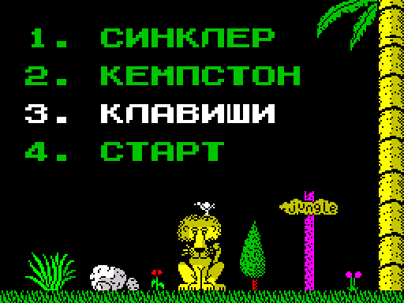
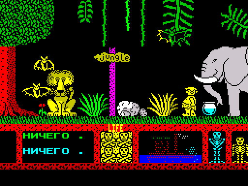

### «Save Game Situation» (ленты 14–18)

Снимок 48K-программы по кнопке NMI в свободные страницы 128K (только в память).
Обработчик ставится в копию ПЗУ в теневом ОЗУ по адресу #386E, вектор #0066
перенаправляется на него.

| Лента | Файл | Содержимое |
|---|---|---|
| 17 | `Save Game` | загрузчик на BASIC под `NEW3RA`/`NEW4RA` |
| 18 | `Save Game` | загрузчик на BASIC под `NEW2RA` |
| 18 | `RomRamCopy` | копирование ПЗУ в теневое ОЗУ (CODE 64000, 25 байт) |
| 18 | `NEW2RA.EXE` | обработчик, 278 байт: только SPACE/B, синхронизация по `HALT` |
| 14 | `NEW3RA.TXT` | исходник `NEW3RA` (не совпадает с EXE: 4 лишних байта в начале) |
| 15 | `NEW3RA.EXE` | 258 байт; **ошибка**: `SP` не возвращается на стек программы |
| 16 | `NEW4RA.EXE` | 260 байт; исправление — `LD SP,(#FFFE)` |

Клавиши (`NEW3RA`/`NEW4RA`): SPACE — сохранить, B — восстановить, C — пропустить;
при выходе (зелёный бордюр) SYM SHIFT — вернуться с `EI`, N — с `DI`.

Память: #4000 → страница 1, #8000 → страница 3, #C000 (страница 7) → страница 4,
регистры → страница 6.

Известная ошибка во всех вариантах `NEW3RA`/`NEW4RA`: вопрос про `IM 2` задаётся при
`I` < #3F, а должен при `I` > #3F. Исправление: `CP #40 : JR C` (байты `3F 30` → `40 38`
по адресу #3928). Подробный комментированный листинг — `transparent_a_16/NEW4RA.EXE.asm`.

### Порт ORDOS (ленты 01–03)

Три версии одного ассемблерного исходника (~1170 строк): ORDOS 2.0 от «Ориона-128»,
переделанная в самостоятельную программу для Спектрума. Собранного кода на лентах нет,
только тексты. Разбор по чтению исходника.

Исходник получен дизассемблированием оригинала: метки вида `LB8xx`–`LBFxx` (адреса
ORDOS, #B800–#BFFF), осмысленные имена даны только точкам входа, а строка с именем файла
автозапуска так и осталась «командами» (`LD B,L : LD E,B : LD D,H : JR NZ,…`). Директивы
`ORG` в тексте нет. Таблица переходов ORDOS в конце (#BFBE–#BFFD) сохранена.

Что переделано под Спектрум:

| Что | Как |
|---|---|
| вывод | `RST 16` из ПЗУ Спектрума вместо Монитора «Ориона» |
| ввод | системная переменная `LAST-K` (23560), 255 — «клавиши нет»; `PRESED` — опрос порта 254 |
| диск B (ОЗУ-диск) | свои `READ`/`WRITE`: адрес `HL` читается через окно #C000 с подключением страницы портом #7FFD |
| перезагрузка системы с диска A | отключена (`REBOOT JP NOBOOT`) |
| выход | в `DOSM4` клавиша с кодом 14 уходит в BASIC (`JP 4777`) |

`READ`/`WRITE` выбирают страницу по двум старшим битам адреса: #0000–#3FFF — страница 0,
#4000 — 5, #8000 — 2, #C000 — 7. Три последние — это та же память, что и так стоит на
этих адресах, так что по сути процедуры дают доступ к 16 КБ под ПЗУ, не отключая само
ПЗУ (оно нужно для печати и клавиатуры). Диск B начинается с адреса 0.

Версии:

| Лента | Файл | Что изменилось |
|---|---|---|
| 01 | `DOSM2.TXT` | баннер «O R D O S (C) VERSION 2.00». В таком виде не собирается: нет меток `LB82B` и `LBD5B`, сообщения об ошибках заданы через `DEFW` вместо `DEFM` |
| 02 | `DOSM3.TXT` | эти ошибки исправлены; из баннера убраны коды #1F и #0A, которых ПЗУ Спектрума не понимает; убрана запись в `RAMTOP` |
| 03 | `DOSM4.TXT` | баннер «S I D O S (C) VERSION 1.00», выход в BASIC |

Что осталось не так:

| Где | Что |
|---|---|
| диск A | обращения к ПЗУ-диску «Ориона» оставлены как запись и чтение ячеек #F500–#F503. На Спектруме это обычная память, диск A читает один и тот же байт; при этом система стартует именно с диска A |
| размер диска B | верхняя граница осталась орионовской, #EFFF. Всё, что не поместится в первые 16 КБ, будет писаться через те же `READ`/`WRITE` в экран, системные переменные, BASIC и саму DOS |
| `NOBOOT` | после отключения перезагрузки `POP AF` снимает со стека слово, которое туда клал не он; работает за счёт того, что перед этим `CONSOL` как раз положил адрес возврата |
| порт #7FFD | значения 0, 2, 5, 7 пишутся без бита выбора ПЗУ. На этой машине бит ничего не делал (ПЗУ 128K не было), а на оригинальном 128K это включило бы ПЗУ редактора вместо BASIC |

Со слов владельца, позже он написал собственную DOS, тоже с вызовами через `FN`. На этих
двух кассетах её нет: через `DEF FN` вызываются только функции E.G.-BASIC и родственные
им процедуры печати и спрайтов.

DOS самостоятельная и опирается на ПЗУ Спектрума; с эмулятором «Ориона» с кассеты
`green_svema`, который работает при отключённом ПЗУ и держит по #F500 таблицу
прерываний, она в таком виде несовместима.

### Музыкальная карта IMC-1 (ленты 22–24, 27, 28)

Прошивка отдельной платы-сопроцессора, а не код для Спектрума: эмулятор AY-3-8910 на
втором Z80 и таймере КР580ВИ53. Полное название — «Intellectual Music Card». Работа
прошивки разобрана по исходникам, образ версии 2.0 сверен с исходником
дизассемблированием; устройство платы — по рукописной [схеме и описанию](#схема-и-описание-платы)
из директории `IMC/` и со слов владельца.

| Лента | Файл | Содержимое |
|---|---|---|
| 22 (WAV) | `BIOS.TXT` | исходник версии 1 (`ORG 73`) |
| 23 | `BIOS.OBJ` | собранная версия 1, 290 байт с адреса 73 |
| 24 | `BIOS-2.TXT` | она же (это код, не текст), собранная на два байта выше |
| 27 | `B-2.0.TXT` | исходник «BIOS IMC-1 V2.0», 199 строк |
| 28 | `B-2.0.EXE` | образ версии 2.0 с адреса 0, 437 байт; совпадает с исходником |

Порты сопроцессора:

| Порт | Запись | Чтение |
|---|---|---|
| 0, 1, 2 | делители трёх каналов таймера | |
| 3 | управляющее слово таймера (#36, #76, #B6 — все три канала в режиме меандра) | |
| 4 | биты 0–2 — разрешение тона каналов A, B, C; биты 3–5 — шум | номер регистра AY из защёлки |
| 8 | ключи громкости | данные из защёлки |
| 12 | импульс по биту 7 — «принято», сбрасывает запрос | бит 7 — есть необработанная запись |

ОЗУ — #2000–#27FF: регистры AY лежат с #2000 (регистр N в ячейке #2000+N), стек сверху.

Главный цикл обеих версий:

- **Тон.** Период из регистров 0–5 пишется в делители таймера как есть, оба байта.
  Таймер тактируется частотой 125 кГц — это 2 МГц со Спектрума, делённые на 16
  счётчиком на плате, — так что высота совпадает с AY при тактовой 2 МГц.
- **Шум** программный: раз в (регистр 6) проходов берётся очередной байт собственного
  кода прошивки как «случайный», из него три бита накладываются на маску микшера и
  выдаются в биты 3–5 порта 4. Частота шума зависит от скорости главного цикла.
- **Громкость.** Из четырёх бит громкости каждого канала берутся два старших — по два
  ключа на канал, шесть из восьми: биты 0–1 порта 8 — канал A, 2–3 — B, 4–5 — C.
  При громкостях 0–3 оба ключа канала закрыты, но тишины это не даёт: на плате сигнал
  идёт ещё и в обход ключей, через постоянный резистор (см. ниже), а сама прошивка канал
  при этом не глушит — тишина получается только выключением тона в регистре 7. Ключей на схеме столько же: шесть на громкость, по два на канал.
  Владелец помнил 3 + 2 + 3, но на схеме седьмой ключ занят другим (см. ниже), а восьмой
  свободен.
- **При включении** — проверка ОЗУ и мелодия из 16 нот на двух каналах: нисходящее
  минорное арпеджио, последняя нота октавой ниже первой.

Чем отличаются версии:

| | Версия 1 | Версия 2.0 |
|---|---|---|
| приём записи | опрос: главный цикл читает бит 7 порта 12 | обработчик NMI по адресу #66 |
| номер регистра | не ограничен | маска на 0–15 |
| «регистр 16» | переход в конец кода | программный сброс: `RST #38`, там `JP INIT` |
| проверка ОЗУ | 16 байт | все 2 КБ, тремя значениями |
| огибающая | нет | заглушка, см. ниже |

Версия 1 с NMI несовместима: её код занимает адреса #49–#16A, и вектор #66 приходится
на середину начальной инициализации — каждый NMI запускал бы прошивку заново, с мелодией.
То есть она работала только пока сигнал NMI на сопроцессор не подавался.

Огибающая в версии 2.0 не реализована. Для канала, у которого в регистре громкости
установлен бит 4 («громкость от огибающей»), вместо регистра берётся ячейка #2010 — но в
неё ничего не пишет: генератора огибающей в прошивке нет, а запись в «регистр 16» с
внешней стороны перехвачена под сброс. После проверки ОЗУ там ноль, и такой канал просто
молчит. Регистры 11–13 сохраняются, но не используются. В остальном версия 2.0 по коду
рабочая.

Судя по этому, версия 2.0 — промежуточная: место под огибающую в ней подготовлено
(проверка бита 4, отдельная ячейка сразу за шестнадцатью регистрами), а сама огибающая
должна была появиться в следующей версии. Её на этих кассетах нет. На то же указывает и
расхождение с раскладкой ключей громкости, которую помнит владелец.

#### Схема и описание платы

В директории `IMC/` лежат две фотографии 2014 года: рукописная схема (`DSC_1665.jpg`,
обработанная копия — `schematic.jpg`) и страница описания «INTELLECTUAL MUSIC CARD V1.0»
(`DSC_1666.jpg`, повёрнутая копия — `description.jpg`). Ниже — то, что с них читается;
номиналы и названия сигналов взяты со схемы. Типы микросхем на ней не подписаны: регистры —
КР1533ИР23 (со слов владельца), остальное определено по номерам выводов — буфер подходит под
АП6 (вывод 1 — направление, 19 — разрешение, стороны на выводах 2–9 и 18–11), дешифраторы
под ИД4, счётчик под К561ИЕ10 (вход C на земле, такт подан на EN, выходы на выводах 3–6
— у ТТЛ-счётчиков 1533ИЕ10 и ИЕ19 выводы назначены иначе), ключи — К561КТ3. Со слов владельца, ТТЛ-микросхемы на плате
скорее всего все были серии 1533 (то есть и дешифраторы — КР1533ИД4), сдвоенный триггер —
почти наверняка 1533ТМ2, шесть инверторов — вероятно, 1533ЛН1, а ключи — точно К561КТ3, и
было их у него ровно две. Номера выводов на листе с ТМ2 и ЛН1 сходятся, кроме одного места:
у второго триггера цифра 8 стоит у прямого выхода, а 9 — у инверсного, тогда как у ТМ2
наоборот. Владелец считает это ошибкой на листе, и разбор с ним согласен: `TRS` должен
идти именно с инверсного выхода (вывод 8). Прошивка сбрасывает запрос, записывая в порт 12
сначала 128, потом 0, и с прямого выхода триггер запроса после этого остался бы
принудительно установленным. На перерисованной схеме номера даны по ТМ2.

Перерисованная схема (`IMC/schematic_redrawn.png`, строится скриптом
`IMC/draw_schematic.py`). Связи, как и в оригинале, заданы именами цепей. Синим — то, что
есть на листе; красным — то, что по фотографии прочитать не удалось; зелёным — то, чего
на листе нет и что восстановлено по разбору (NMI и WAIT) (картинка открывается в полном
размере по щелчку):

[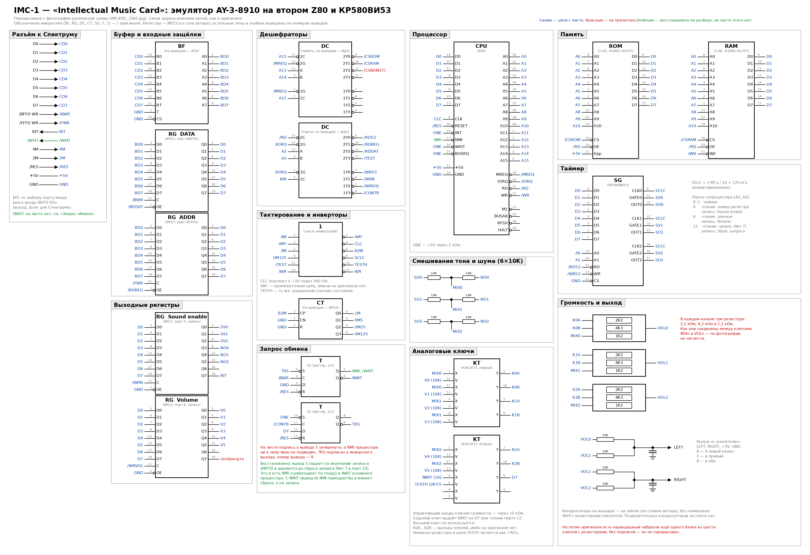](IMC/schematic_redrawn.png)

Исходная фотография после обработки:

[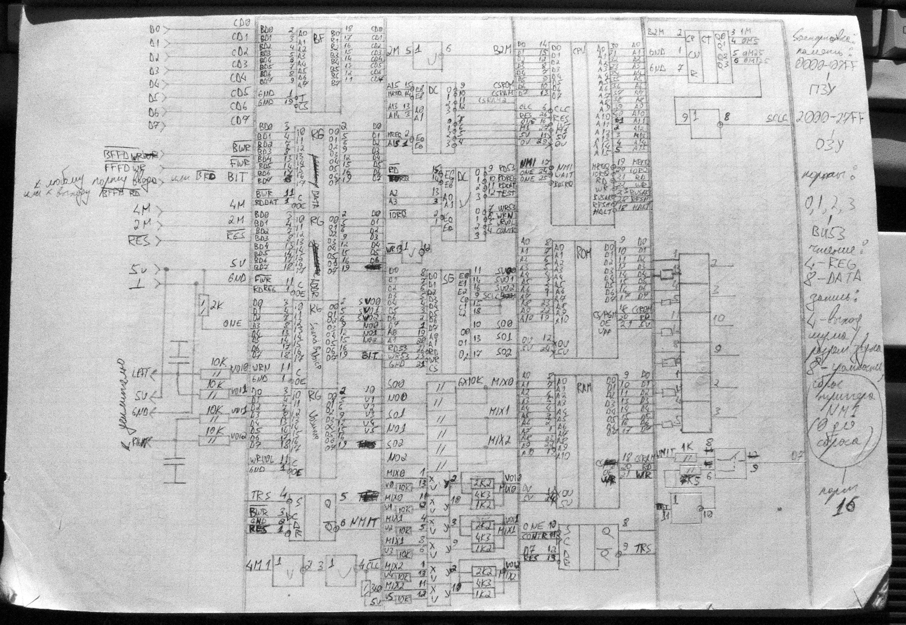](IMC/schematic.jpg)

**Связь со Спектрумом.** На разъёме: шина данных D0–D7, стробы записи `/BFFD WR` и
`/FFFD WR`, такты 4 МГц и 2 МГц, сброс, питание и линия `BIT`. Шина данных проходит через
буфер только в одну сторону, к плате, так что читать регистры AY Спектрум не может.
Сигнала WAIT для основного процессора на этой схеме нет; вместо него линия `BIT` — бит 7
регистра порта 4, с пометкой «к любому порту ввода или к входу `/BFFD RD`», то есть флаг,
который Спектрум мог бы опрашивать. Со слов владельца, `BIT` закладывался как
обратная связь — последовательная линия от платы к Спектруму: другого способа что-либо
передать обратно у платы нет. Прошивки с кассет этот бит не используют.

**Два регистра-защёлки** принимают данные и номер регистра по стробам `/BWR` и `/FWR`;
на шину сопроцессора они выдаются сигналами чтения портов 8 и 4.

**Запрос.** Триггер запроса взводится только стробом записи данных (`/BWR`); запись
номера регистра его не трогает. Состояние триггера (`NMIT`) читается сопроцессором как
бит 7 порта 12 — через аналоговый ключ, использованный как вентиль с третьим состоянием.
Сбрасывает запрос второй триггер, который защёлкивает бит 7 при записи в порт 12; на
полях помечено «сброс триггера NMI (0 для сброса)».

У триггера запроса подписан только инверсный выход — `NMIT`; подпись у прямого выхода
зачёркнута. Если NMI процессора взят с `NMIT`, как предполагает владелец, то схема с
прошивкой 2.0 работать не может, и вот почему:

| Событие | `NMIT` | Что видит вход NMI |
|---|---|---|
| сброс платы | 1 | — |
| прошивка сбрасывает запрос при старте | 1 → 0 | спад: NMI срабатывает, хотя записи не было |
| Спектрум пишет данные в #BFFD | 0 → 1 | фронт: ничего |
| обработчик сбрасывает запрос | 1 → 0 | спад: NMI |

Вход NMI у Z80 срабатывает по спаду, а `NMIT` при записи данных растёт. Спад получается
только в момент сброса запроса — но в версии 2.0 запрос сбрасывает сам обработчик NMI,
который без спада не вызовется. После единственного срабатывания при старте плата
перестаёт реагировать на записи. Версия 1 при такой разводке тоже не работала бы: она
сбрасывает запрос из главного цикла и получала бы NMI на каждую запись, а вектор #66 у
неё попадает в середину инициализации. Раз версия 1 работала, NMI при ней подключён не
был.

С прямого выхода того же триггера (вывод 5) всё получается:

| Событие | Вывод 5 | Что происходит |
|---|---|---|
| сброс платы | 0 | спада нет, NMI не срабатывает |
| прошивка сбрасывает запрос при старте | 0 → 1 | ничего |
| Спектрум пишет данные в #BFFD | 1 → 0 по окончании записи | NMI; данные в защёлке уже стоят |
| обработчик сбрасывает запрос | 0 → 1 | готов к следующей записи |

Этот же сигнал по форме — готовый WAIT для основного процессора: ноль от конца записи до
сброса запроса. Z80 проверяет WAIT в каждом машинном цикле, так что Спектрум остановился
бы на следующей же команде и стоял, пока сопроцессор не заберёт данные. Без такой
остановки записи терялись бы: обработчику нужно порядка 130 тактов, чтобы прочитать номер
регистра и данные, а проигрыватель успевает за это время переключить номер регистра и
записать следующий байт.

Владелец помнит, что WAIT на основной процессор был, и считает, что схема могла остаться
необновлённой после доработок; `TRS` при этом — общий сброс и для NMI, и для WAIT. Это
согласуется с разбором: второй триггер меняется только по записи сопроцессора в порт 12,
сам выставить WAIT в момент записи со Спектрума он не может, а вот сбрасывает первый —
и тем самым снимает и NMI, и WAIT. Зачёркнутая подпись у вывода 5 могла быть как раз этой
цепью. На перерисованной схеме этот вариант показан зелёным: NMI процессора и линия
`/WAIT` на разъёме взяты с вывода 5. Как именно WAIT развязан с шиной Спектрума (диод,
открытый коллектор), неизвестно.

**Сопроцессор.** Z80 тактируется теми же 4 МГц, что и основная машина; его входы WAIT,
INT и BUSRQ подтянуты к единице. Со слов владельца, сначала запрос хотели подавать на
INT, а не на NMI, но так не заработало — по его предположению, из-за неподходящей
длительности сигнала (осциллографа для проверки не было). Версия 1 прошивки с кассеты
прерываний не разрешает вовсе и опрашивает запрос сама. ПЗУ на 2 КБ с адреса #0000, ОЗУ на 2 КБ с #2000;
дешифратор памяти работает по A13–A15.

Тактовый вход процессора (`CLC` на схеме) подтянут к +5 В через 360 Ом, и это сделано
правильно. У n-МОП Z80 вход CLK не ТТЛ-совместим: единица на нём должна быть не ниже
Vcc − 0,6 В, то есть около 4,4 В, а ТТЛ-выход гарантирует 2,4 В и реально даёт около
3,5 В. Zilog для такого случая рекомендует подтяжку 330 Ом; 360 Ом — соседний номинал.
Резистор такой маленький, чтобы успевать перезаряжать ёмкость входа: на 4 МГц фронты
такта тоже нормированы.

**Порты** дешифруются по A2 и A3, поэтому идут с шагом 4:

| Порт | Чтение | Запись |
|---|---|---|
| 0–3 | таймер | таймер |
| 4 | `RDREG` — номер регистра | `WRN` — разрешение тона, шум, `BIT` |
| 8 | `RDDAT` — данные | `WRVOL` — громкость |
| 12 | `TEST` — запрос | `CONTR` — сброс запроса |

Это в точности та раскладка, которая получилась из прошивки.

**Таймер.** 2 МГц через инвертор идут на четырёхразрядный счётчик; с его старшего
выхода снимаются 125 кГц и подаются на все три канала ВИ53. Биты 0–2 порта 4 заведены на
входы разрешения счёта каналов.

**Шум и смешивание.** Биты 3–5 порта 4 — три «шумовых» выхода. Каждый складывается со
своим каналом таймера на резисторах 10 кОм (подпись «6×10K») — без логики, простым
суммированием.

**Громкость.** Шесть аналоговых ключей, по два на канал, управляются битами 0–5 порта 8
через резисторы 10 кОм. В каждом канале три резистора — 2,2 кОм, 4,3 кОм и 1,2 кОм.
4,3 кОм стоит постоянно между входом ключей (`MIXn`) и выходом канала (`VOLn`) — на листе
он подведён к `VOLn` петлёй поверх блока; 2,2 кОм и 1,2 кОм подключаются параллельно ему
каждый своим ключом (младший бит пары — 2,2 кОм, старший — 1,2 кОм). Проводимости
относятся примерно как 1 : 2 : 4, то есть это трёхразрядный ЦАП, у которого младший
разряд включён всегда: уровни 1, 3, 5 и 7 из семи. Зачем так — на листе не написано;
похоже, чтобы код 00 не был тишиной: прошивка берёт только два старших бита громкости,
и иначе ноты с громкостью 0–3 пропадали бы совсем.

**Выход — стерео:** канал A идёт в левый, C в правый, B через два резистора по 10 кОм в
оба.

**Описание** («INTELLECTUAL MUSIC CARD V1.0») повторяет карту портов и памяти и
добавляет:

- по сбросу звук и шум глушатся, в буфер регистров пишутся нули и #FF в регистр 7;
- при записи по адресу #BFFD сопроцессор обслуживает NMI по адресу 102, переписывает
  данные в буфер регистра и, сняв со стека адрес возврата, переходит на начало цикла;
- громкость задаётся младшими битами регистров 8–10, бит 4 разрешает огибающую;
- регистры 11–12 — частота огибающей, 13 — форма, с таблицей всех восьми форм от
  1000 до 1111 с пометками «с повтором» и «без повтора».

То есть огибающая была в замысле с самого начала, а описание с номером 1.0 уже говорит
про NMI по адресу 102 — как в прошивке 2.0, а не как в версии 1 с кассеты. Отличие от
прошивки 2.0 одно: там обработчик возвращается обычным `RET`, а не уходит на начало
цикла.

[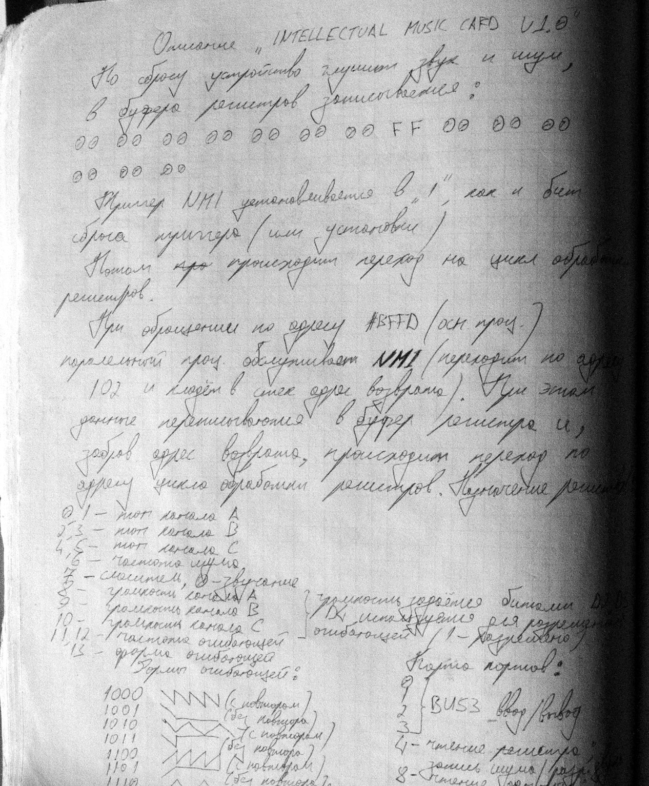](IMC/description.jpg)

#### Задним числом: что в плате можно было сделать иначе

Этого нет ни на кассетах, ни на листе — это итог обсуждения схемы с её автором. Его
собственный вывод: вся плата работала на честном слове, и удивительно, что заработала.

**Общая подтяжка `ONE`.** Один резистор 2 кОм к +5 В подтягивает сразу четыре входа:
`/INT`, `/WAIT` и `/BUSRQ` процессора и вход установки второго триггера. Пока все они
должны быть в единице, это работает, но входы при этом просто соединены между собой:
чтобы задействовать любой из них как сигнал, его надо сначала отрезать и дать ему свой
резистор. Правильнее — отдельная подтяжка на каждый вход.

**Ключи и громкость.** Из восьми ключей шесть управляют громкостью (по два бита на
канал), один служит портом ввода для единственного бита `NMIT`, один свободен. Громкость
в итоге очень грубая: четыре ступени на канал против шестнадцати у AY, и тишины среди них
нет. Замолкает канал только через микшер: биты тона регистра 7 идут на входы `GATE`
таймера. Плеер, который глушит ноту громкостью 0, не выключая тон, на этой плате оставлял
бы её звучать на низшей ступени.

К тому же ступени эти, по расчёту, почти не различались. Веса 1 : 2 : 4 получаются, только
если цепочка резисторов работает на низкоомную нагрузку. Здесь же перед ней 5 кОм (два
резистора по 10 кОм, смешивающие тон с шумом), а после — 10 кОм выходного сумматора, и на
их фоне её собственное сопротивление меняется всего от 4,3 до 0,66 кОм (плюс
сопротивление открытых ключей). Разница между крайними уровнями выходит 1–2 дБ. Это оценка
по номиналам с листа; как громкость звучала на деле, владелец не уточнял.

То же количество микросхем позволяло больше, если поменять местами сигнал и управление:

1. Биты громкости с выходов регистра через резисторы с весами 1 : 2 : 4 сводятся в одну
   точку. Получается напряжение, пропорциональное коду, — простейший ЦАП без единого
   ключа.
2. Тон подаётся не на вход ключа, а на его управление: ключ «рубит» это напряжение, и
   на выходе получается меандр с размахом, равным уровню громкости.

Тогда на канал нужен один ключ при любой разрядности, а число уровней ограничено только
выходами регистров. У регистра громкости их восемь, девятый можно взять со свободного
выхода 6 регистра «Sound enable» — выходит 3 + 3 + 3, по восемь уровней на канал.
Ключей при этом нужно всего четыре — три на тон и один на чтение `NMIT`, — то есть ровно
одна К561КТ3: вторая микросхема оказалась бы лишней.
Оговорки: у ТТЛ-регистра уровень единицы неточный, так что ступени получатся неровными;
тон с шумом пришлось бы смешивать логически, вентилем на канал, а не резисторами (что
ближе к настоящему AY); логарифмическую шкалу громкости AY надо пересчитывать в линейный
код таблицей в прошивке; девятый бит живёт в регистре, который главный цикл постоянно
переписывает, и его нужно подмешивать в каждую запись.

**10 кОм на управлении ключей.** Биты громкости идут с выходов регистра на управляющие
входы К561КТ3 через последовательные резисторы 10 кОм. Пользы от них почти нет: вход
КМОП тока не потребляет, а постоянная времени с его ёмкостью — десятки наносекунд. Так
обычно защищали входы К561, но при общем питании +5 В защищать их не от чего. Те же
резисторы были бы на месте подтяжкой к +5 В: КМОП при 5 В нужна единица не ниже 3,5 В,
а выход КР1533ИР23 гарантирует только Vcc − 2 В, то есть 3 В (реально без нагрузки около
3,5–3,8 В). Работало это за счёт того, что настоящий порог ключа — около половины
питания; с подтяжкой уровень дотягивался бы до питания с честным запасом.

**Счётчик-делитель.** К561ИЕ10 делит 2 МГц, а при питании 5 В его предельная частота
гарантируется около 1,5 МГц при типовой порядка 3 МГц. К тому же такт приходит с
ТТЛ-инвертора — с тем же недобором уровня единицы, что и у ключей. На большинстве
экземпляров это работает, но запаса нет, а сбой делителя сдвинул бы высоту всех нот
сразу. Надёжнее было делить ТТЛ-счётчиком той же серии 1533.

**Конденсаторы на выходе.** У выходов `LEFT` и `RIGHT` стоит по конденсатору, вторые
обкладки — на земле. Это не развязка по постоянному току, а фильтр нижних частот: вместе
с резисторами смесителя (два по 10 кОм на выход, то есть около 5 кОм) он срезает
гармоники меандра, щелчки от переключения ключей громкости и наводки с шины. Номиналов
на листе нет; для среза около 10 кГц при 5 кОм нужно примерно 3,3 нФ, а 10 нФ дают уже
3 кГц. Постоянная составляющая при этом уходит в усилитель: сигнал однополярный, а
разделительных конденсаторов на плате нет. Если у усилителя нет своего конденсатора на
входе, после фильтра стоило добавить последовательный — по одному на канал.

**`BIT` как обратный канал.** Шина данных через буфер идёт только к плате, поэтому `BIT`
— единственное, что плата может сообщить Спектруму. Вместе с WAIT он даёт простой и
быстрый последовательный обмен без ожиданий в цикле:

1. Спектрум пишет в #FFFD номер особого регистра. Защёлка адреса восьмибитная, так что
   свободных номеров 240.
2. Спектрум пишет в #BFFD команду, например «следующий бит».
3. Запись останавливает Спектрум через WAIT и вызывает NMI на плате.
4. Обработчик выставляет бит на `BIT` и только после этого сбрасывает запрос.
5. WAIT снимается, Спектрум следующей командой читает порт и получает уже установившийся
   бит.

Гонок нет: бит выставлен до снятия WAIT и держится до следующей команды. На бит уходит
порядка 250 тактов, то есть около двух килобайт в секунду при 4 МГц. Так можно было бы
отдавать номер версии прошивки или содержимое регистров AY, которые напрямую прочитать
нельзя. В прошивке для этого нужно хранить текущее значение `BIT` в ячейке и подмешивать
его в каждую запись порта 4, а также снять маску с номера регистра, которая в версии 2.0
обрезает его до четырёх бит.

### `PATCH.EXE` — тон через порты AY (ленты 25, 26)

Процедура уже для Спектрума, а не для платы: пишет в порты AY (#FFFD и #BFFD), то есть
работает и с настоящим AY, и с [IMC-1](#музыкальная-карта-imc-1-ленты-2224-27-28).

| Лента | Файл | Адрес |
|---|---|---|
| 25 | `PATCH.EXE` | #F900, 117 байт |
| 26 | `PATCH2.EXE` | тот же код, перенесённый на #F918 |

Вход в `C`: 0, 1 или 2 — задать каналу A, B или C период тона из `HL`, сдвинутого на 4
бита вправо, и включить его тон в микшере; 3 — выключить тон на каналах, заданных двумя
старшими битами `H` и `L`, и шум на всех. Копия регистра микшера хранится в последнем
байте процедуры. Комментированные листинги — `transparent_a_25/PATCH.EXE.asm` и
`transparent_a_26/PATCH2.EXE.asm`.

В коде ошибка: после `INC C` стоит `CP 3`, но сравнивается `A`, а не `C`, поэтому
поправка маски 3 → 4 не срабатывает, и для канала C получается маска #FC вместо #FB —
вместо тона C включаются тоны A и B.

### PcOut — передача файлов на PC (ленты 29, 30)

Читает с ленты файл типа Bytes и передаёт его на PC через ВВ55: побитно, старшим битом
вперёд, с подтверждением каждого бита; перед данными 4 байта — адрес старта и длина.
Ответная программа для PC не сохранилась.

| Лента | Файл | Содержимое |
|---|---|---|
| 30 | `PcOut.BAS` | оболочка на BASIC |
| 30 | `PCOUTOK.TX`, `PCOUTOK.EX` | исходник и код передатчика (CODE 23296, 54 байта) |
| 29 | `PC-OUT`, `PCOUT.EXE` | более ранняя версия: без настройки ВВ55 и выхода по клавише |

### Звуковой сэмплер (ленты 04–07)

| Лента | Файл | Содержимое |
|---|---|---|
| 05 | `MUSIC.BAS` | оболочка: REC / PLAY / CONST / DIAGRAM / VYBOR |
| 06, 07 | `MUSIC-2.BA`, `MUSIC-2.BS` | две следующие версии оболочки |
| 04 | `DIAGR65000` | подсчёт единичных битов для графика (CODE 65000, 28 байт) |

Кода записи и воспроизведения (адрес 64000) на лентах нет.

## Кассета `green_svema`

103 записи на двух сторонах: `green_svema/side_1/svema_NN.wav` и
`green_svema/side_2/svema_b_NN.wav`. Всё прочитано `wav2tap.py`, все блоки сошлись по
контрольной сумме. Рядом с каждым WAV лежит `.tap` и директория с распакованным содержимым.

### Что на стороне 1

| Записи | Что это |
|---|---|
| 12–25, 27–35, 39–49 | **Среда «Радио-86РК» для Спектрума** («Radio-interface. Written by GOLDFISH CORP.»): два поколения, много промежуточных кусков, полная сборка первого поколения на записи 27; [разбор](#эмулятор-радио-86рк) |
| 26 | `RADIO FILE` — программа для самого «Радио-86РК»: игра «Питон» («*** piton ***», 399 байт с адреса #1100), работает через вызовы Монитора #F803/#F818; [перенос на Спектрум](#питон-для-спектрума-запись-26) |
| 50, 50_2 | **«ORION-128 EMULATION WITH 96K»** — эмулятор РК первого поколения, доработанный под «Орион-128», 7535 байт с адреса 58000; [разбор](#эмулятор-орион-128-запись-50). Порт ORDOS с лент `transparent_a_01–03` — отдельная программа и с этим эмулятором не связан |
| 28–32 | кусок ПЗУ 48K (запись 28) и Монитор РК на разных стадиях ручного набора; [разбор](#ранние-версии-печати-и-монитора) |
| 33, 34, 48 | шрифты РК: 768 байт и 1024 байта; [разбор](#ранние-версии-печати-и-монитора) |
| 36–38 | три версии исходника печати эмулятора РК; [разбор](#ранние-версии-печати-и-монитора) |
| 1, 5–8, 10 | ранние версии печати, `MONITRT`/`MONITR`, `mode8/64`; маленькие `Musik CODE` и `Correct Co` — куски сэмплера; [разбор](#ранние-версии-печати-и-монитора) |
| 2, 3 | `READ-HEAD` — чтение заголовков с ленты, набрано из польского издания; [разбор](#read-head) |
| 4 | `Russian!` — русский шрифт, 768 байт; [разбор](#ранние-версии-печати-и-монитора) |
| 11 | `Programato` — код `PROG+`, перенесённый в строку `REM` и настроенный на прошивку 27256 из адресов #0000–#3FFF; [разбор](#programato-сторона-1-запись-11) |

### Что на стороне 2

| Записи | Что это |
|---|---|
| b_01–b_27 | **«E.G.-BASIC»** — расширение BASIC для аппаратного мультиколора «Балтика» и набор служебных функций; [разбор](#eg-basic) |
| b_28, b_35 | спрайты: своя процедура `Sprites .1` под экран с цветом 8×1 и редактор расстановки `SCREEN!` на Laser Basic; [разбор](#спрайты-sprites-1-и-screen). Запись `b_29` — безымянная копия `Haintmonc$` |
| b_30, b_31 | `HAINTMON` — резидентный монитор памяти в теневом ОЗУ; [разбор](#haintmon) |
| b_32 | `Paint M.-2` — экран графического редактора с панелью инструментов |
| b_36–b_38 | музыкальный редактор `EDIT-3`: два исходника и код (640 байт, адрес 61000); [разбор](#музыкальный-редактор-и-мелодии) |
| b_39–b_44 | мелодии к нему, по 3000 байт: `\|to ws[`, `CANCONA`, `FEELINGS`, `STAIRWAY`, `FREEDOM`, `BAD BOYS` |
| b_33, b_34 | `I WANT TO`, `LET IT BE` — ещё две мелодии, по 2000 байт с адреса 60000 |
| b_45 | загрузчик «Radio-86RK emulator. Written by GOLDFISH CORPARATION» с описанием клавиш |
| b_46, b_47 | **`PROG+`** — программатор ПЗУ 2716/2764/27128/27256; [разбор](#программатор-пзу-prog) |
| b_51 | `VOICER` — редактор гитарных табулатур на BASIC; [разбор](#voicer) |
| b_48–b_50, b_52 | мелкий код без имени (104 байта с адреса 64000), исходник на 151 строку, `Music` |

Экран `Paint M.-2`:

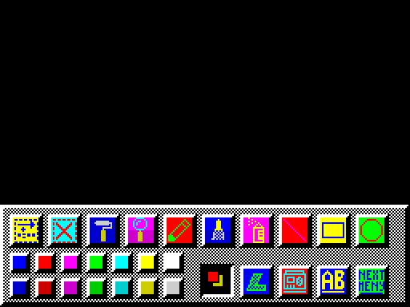

Шрифт «Радио-86РК» (1024 байта, запись 34):

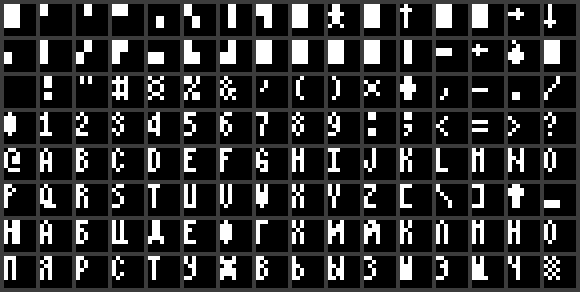

### Эмулятор «Радио-86РК»

Не эмулятор процессора, а среда совместимости: код РК (8080) исполняется на Z80 как есть,
подменено окружение. Написан владельцем лет в 14; `IM 2` делался подбором, без примеров.
Разбор — по чтению кода, без запуска.

Общее для обоих поколений:

- включается теневое ОЗУ, программа РК живёт в #0000–#3FFF; системная область РК сдвинута
  вниз на #4000 (видеопамять #76D0 → #36D0, первый видимый символ #77C2 → #37C2);
- экран 64 символа в строке, знаки шириной 4 точки из своего шрифта;
- кадровое прерывание перерисовывает по одной строке экрана из копии видеопамяти — для
  программ, которые пишут в видеопамять напрямую;
- `IM 2` с `I`=#F5 и таблицей из нулей в #F500–#F5FF. Шина данных «Балтика» подтянута к
  единице, вектор всегда читается как `I`·256+#FF; старший байт берётся из #F600, где
  стоит первая команда обработчика `PUSH AF` = #F5. Получается адрес #F500, и процессор
  проезжает 256 `NOP` до обработчика.

#### Первое поколение — «Radio-interface» (запись 27, полная сборка)

| Блок | Адрес | Что |
|---|---|---|
| `Monitor co` | #E290 | свой Монитор: команды G, F, I, M, O, S, L |
| `Radio Font` | #EA60 | шрифт, 128 знаков |
| `INT CODE` | #F600 | обработчик прерывания |
| `TABLE MON.` | #F800 | таблица переходов с адресами Монитора РК |
| `RadioBlok` | #F86F | печать, клавиатура, лента (копии `SA-BYTES`/`LD-BYTES` из ПЗУ) |

Записи 12–21 (`RADIOFILE1`…`E`) — те же процедуры `RadioBlok` по отдельности.
Запись 26 («Питон») сохранена этой версией: формат спектрумовский, имя `RADIO FILE`.

Найденные ошибки:

| Где | Что не так |
|---|---|
| `#F833` | `LD SP,HL : RET` — стек переставлен, возврат уходит в мусор |
| загрузка с ленты | адрес считается через `ADC HL,BC` при установленном переносе — файл ложится на байт выше |
| прерывание | рисует той же процедурой, что и программа, сохраняя только курсор; рабочие ячейки общие — символ, прерванный посреди рисования, дорисовывается мусором |
| прерывание | ~3400 тактов на символ, строка занимает около трёх кадров при запрещённых прерываниях; программе остаётся 10–25% процессора |
| печать | нет прокрутки (после последней строки вывод идёт сверху), нет курсора |
| `#F830` | возвращает 0, пока не вызван `#F833` |
| `#F82A` | контрольная сумма считается не как в РК |
| SYM+A (перерисовка выкл.) | заодно перестают работать CAPS+ENTER и обмен с ВВ55 |
| ВВ55 (#A000–#A003) | управляющее слово из #A003 не пишется в настоящий порт #7F |
| клавиатура | CAPS+буква даёт код минус #41 вместо #40; SYM прибавляет 5 к коду; точка, запятая, плюс и минус не вводятся; стрелки не совпадают с кодами курсора РК |
| Монитор | точка — «отмена ввода», но точку нельзя набрать; каждый байт вводится как две цифры и ENTER |

#### Второе поколение (записи 31–49, только куски)

Свой Монитор заменён настоящим: `RADIOMON3/4` — ПЗУ Монитора РК-86 на родных адресах
#F800–#FFFF с системной областью, перенесённой на #36xx. Таблица переходов направлена на
свои процедуры (`INSYM`, `INKEY`, `KEYBOATEST`, печать), родные процедуры ленты обёрнуты
в `DI`/`EI`, обращения к порту #8002 заменены на `CALL #E290` / `CALL #E293`. Печать
переписана (`PRINTOK-2`, есть исходник): 25 строк по 7 линий, курсор-подчёркивание.

- Ушли: ошибки `#F833`/`#F830`, сдвиг загрузки, своя контрольная сумма, неудобный ввод в
  Мониторе, отсутствие курсора.
- Остались: порча печати прерыванием, медленная перерисовка, клавиатура, отсутствие
  прокрутки в своей печати, зависимость выхода в Монитор от SYM+A.
- Новое:
  - `PRINTOKCO` ничего не пишет в видеопамять, и перерисовка стирает напечатанное;
  - `PRINTOKCO2` это чинит переходом в родную печать Монитора (`JP #FCBA`), но курсоров
    становится два, и на последней позиции экрана они расходятся;
  - `PRINTOKCO2` (вход #E2CA) не стыкуется с `RADIOMON4` с ленты (в таблице #E2CC);
  - `EI`/`DI`, которыми программы РК управляют динамиком, здесь включают и выключают
    кадровое прерывание;
  - вход с магнитофона в куске `LD (#800A)`, вероятно, берёт не тот бит (`RLCA` вместо
    сдвига вправо).

Чего нет на кассете: #E290–#E2C9 (стартовый код и процедуры порта), версии Монитора под
`PRINTOKCO2` и единого блока, который грузил загрузчик «Radio Emu.» с записи `b_45`.

#### Сколько стоила бы перерисовка при оптимальном коде

Оценка по тактам, для 4 МГц (80 000 тактов на кадр). Рисовать надо по два символа сразу
(два знака по 4 точки — один байт экрана) из двух заранее сдвинутых шрифтов: 33 такта на
линию, около 270 на пару при знаке в 7 линий.

| Вариант | Цена | Обход экрана |
|---|---|---|
| как было | ~5,4 млн тактов на экран | ~1,35 с |
| полная перерисовка оптимальной процедурой | ~216 000 тактов, 2,7 кадра | до 19 раз в секунду |
| по одной строке за кадр | 11% кадра | 0,5 с |
| по две строки за кадр | 22% кадра | 0,25 с |
| сравнение с теневой копией, 5 строк за кадр | 14% кадра плюс изменившиеся символы | 0,1 с |

#### Пересборка первого поколения для +2A/+3

В `rk86_plus3/` лежит первое поколение (запись 27), собранное заново из исходника для
sjasmplus: тот же набор директив, та же таблица #F800, тот же формат ленты и шрифт, но
для +2A/+3, с исправленными ошибками и с РК на 32 КБ вместо 16. Как запускать, директивы
и клавиши — в [`rk86_plus3/README.md`](rk86_plus3/README.md). Лент три: `rk86.tap` — сам
эмулятор, `piton.tap` — «Питон» с записи 26 (оригинал для РК) и `basic.tap` — BASIC для
РК-86; вторую и третью читает директива `I`.

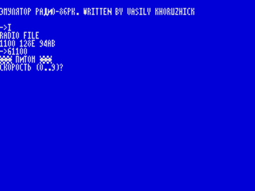
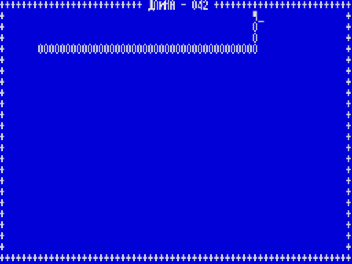
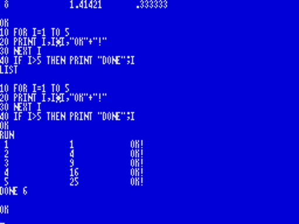
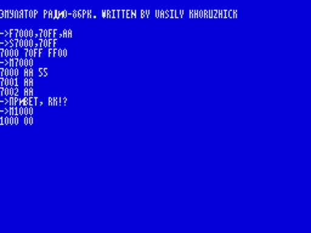

Что перенесено на другую машину:

| На «Балтике» | На +2A/+3 |
|---|---|
| теневое ОЗУ, `OUT (#7E)`; программе РК — 16 КБ, видеопамять в #36D0 | режим «всё ОЗУ», порт #1FFD = 3: страницы 4-5-6-7, и теневой экран (бит 3 порта #7FFD). Экран Спектрума оказывается в #C000, а #0000–#7FFF достаются РК целиком: 32 КБ, видеопамять на родном месте, #76D0 |
| вектор `IM 2` в расчёте на #FF на шине, 256 `NOP` до обработчика | таблица из 257 байт #F7, обработчик по #F7F7, свой стек — от стека программы нужно 2 байта |
| обмен ячеек #A000–#A003 с ВВ55 на портах #1F–#7F | убран: у +2A/+3 этой микросхемы нет |

Эмулятор живёт в странице 7 рядом с экраном (#E290–#F86E), сгенерированный код и шрифты —
в странице 6, в обход адресов портов РК.

Экран рисует только прерывание. Печать Монитора пишет знак в видеопамять РК и больше
ничего не делает, так что общих рабочих ячеек у печати и прерывания нет. Прерывание
каждый кадр сравнивает все 24 строки с теневой копией и перерисовывает изменившееся:

- Теневая копия — это операнды в сгенерированном при запуске коде. На каждую пару
  знаков (один байт экрана) — `POP HL : LD DE,тень : SBC HL,DE : CALL NZ,…`: `SP` идёт по
  видеопамяти РК, сравнение пары стоит 45 тактов, весь экран — 34 560.
- `CALL` при несовпадении записывает адрес возврата поверх только что прочитанной пары.
  Обработчик восстанавливает её (пара = разность + тень), вписывает в код новую тень и
  рисует оба знака из двух заранее сдвинутых шрифтов, разложенных по линиям: 33 такта на
  линию, как в оценке выше, около 460 на пару со всеми расчётами.
- Курсор — мигающее подчёркивание — прерывание накладывает через `XOR` после сравнения и
  снимает перед следующим.

Холостой проход вместе с опросом клавиатуры занимает около 37 000 тактов из 70 908, то
есть половину кадра. Это сделано намеренно: Z80 на 3,55 МГц вдвое быстрее 8080 на
1,78 МГц, и с половиной процессора циклы задержки в программах РК идут с родной
скоростью, а экран обновляется в том же кадре. Перерисовку можно выключить (SYM+A) и
включить (SYM+B).

Что исправлено из [списка ошибок](#первое-поколение--radio-interface-запись-27-полная-сборка)
и сверх него:

| Было | Стало |
|---|---|
| `#F833` переставлял стек | запоминает границу; `#F830` сразу возвращает #75FF |
| загрузка на байт выше | `ADD` вместо `ADC` |
| загрузку нельзя прервать, принимается любой заголовок | SPACE прерывает; берутся только файлы типа `CODE` |
| своя контрольная сумма | алгоритм Монитора РК; `I` и `O` её печатают |
| нет прокрутки и курсора | есть |
| экран чистится пробелами | нулями, как у РК — «Питон» отличает пустую ячейку по нулю |
| `ESC Y` с числами вне экрана пишет мимо видеопамяти | курсор шагает и заворачивается, как в Мониторе РК |
| код 7 печатается знаком | звонок |
| стек — где его оставил BASIC | #76CF, как у РК |
| CAPS+буква на единицу меньше; нет знаков препинания; стрелки с чужими кодами | раскладка по клавишам Спектрума, стрелки — CAPS+5…8 с кодами РК |
| `#F812` и `#F803` смотрят, нажата ли клавиша сейчас | нажатие — событие, как в Мониторе РК: `#F812` о нём сообщает, `#F803` забирает; иначе `LIST` в BASIC принимает ещё не отпущенный ENTER за паузу |
| каждый байт в Мониторе — две цифры и ENTER | строка с параметрами через запятую: `G1100`, `F0,FF,0` |
| SYM+A отключал заодно CAPS+ENTER | отключает только перерисовку |
| мигающее знакоместо в режиме ЛАТ | в режиме РУС |
| нет входа #F86C | тёплый старт, как у Монитора РК |

Судя по коду, на исходной версии «Питон» идти не мог: после очистки экрана пробелами он
не находит ни одной свободной ячейки для еды.

Что изменено в программах РК:

- **«Питон»** — три правки. Строк 24, а не 25: нижняя рамка, длина двух боковых стенок,
  место старта и строка надписи «НАЖМИТЕ <ВК>». Файл на кассете собран под 16 КБ: четыре
  адреса видеопамяти перенесены на #4000 выше. Управление — `Q`, `A`, `O`, `P` вместо
  стрелок. `DI`/`EI` в игре нет, звук — только звонок через Монитор.
- **BASIC** (`BASIC80.RKR` с [rk86.ru](https://rk86.ru/files/BASIC80.RKR)) без правки на
  Z80 не работает: печать любого числа зацикливается. Это код Microsoft для 8080, который
  после сравнения чисел проверяет флаг чётности, а у Z80 этот флаг после арифметики
  показывает переполнение. То же самое в Altair BASIC разобрано в
  [журнале проекта Isetta](https://hackaday.io/project/190345/log/219462-another-interesting-basic-to-test-the-8080-instructions)
  и упомянуто в
  [документации SIMH AltairZ80](https://www.bitsavers.pdp-11.ru/1401/simh_v2.9-10/AltairZ80/altairZ80.txt).
  Исправлено два места (6 байт), подпрограммы на 16 байт легли в нули в конце
  интерпретатора; таблица правок — в [`rk86_plus3/README.md`](rk86_plus3/README.md#свои-программы).
  Загрузки и записи программ BASIC на ленту нет: побайтный обмен с лентой
  (`#F806`, `#F80C`) не сделан.

Любой другой файл РК превращает в ленту для директивы `I` скрипт `rk86_plus3/rkr2tap.py`.

Проверено в симуляторе (ядро Z80 из SkoolKit, модель страниц +3, лента подаётся на вход
EAR): загрузка обеих лент директивой `I`, две минуты игры в «Питона» с едой, ростом,
гибелью и новыми партиями, в BASIC — арифметика, строки, `FOR`, `IF`, `LIST`, `RUN` и
сообщения об ошибках, директивы Монитора, прокрутка, запись на ленту с обратным
декодированием. На контрольных снимках экран совпадает с видеопамятью. Целиком, вместе с
загрузчиком на BASIC, запущено в эмуляторе Xpeccy. На настоящей машине не проверялось.

### «Питон» для Спектрума (запись 26)

Игра с записи 26 написана для самого «Радио-86РК»: 399 байт кода 8080 с адреса #1100,
всё общение с машиной — через Монитор (#F803 ввод, #F809 знак, #F818 строка, #F81B опрос
клавиши, #F821 знак под курсором) и прямую запись в видеопамять. В `piton_zx/` лежит её
перенос на Спектрум 48K, которому ни Монитор, ни теневое ОЗУ не нужны:

```
cd piton_zx && make        # sjasmplus piton.asm -> piton.tap
```

`piton.tap` — загрузчик на BASIC и один блок кода (шрифт и игра, #8000–#86FC, запуск с
33792). Управление: `5` `6` `7` `8` или `Q` `A` `O` `P`, <ВК> — ENTER.

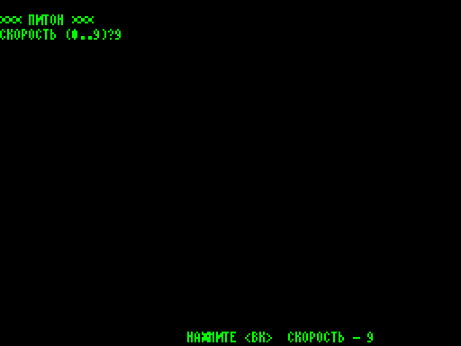
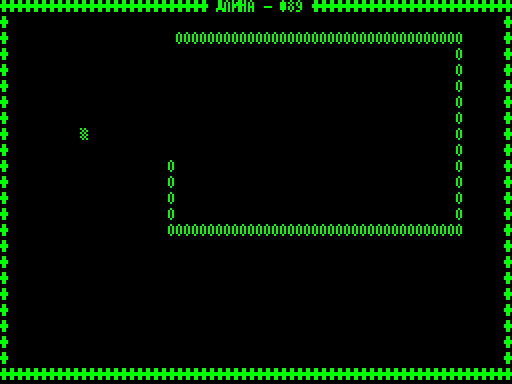

Как устроен оригинал и что из этого сохранено:

- Поле — это сама видеопамять: 0 в ячейке — пусто, #7F — еда, любой другой знак —
  препятствие, включая рамку из `+` и надписи в ней. В порте то же самое делает буфер
  64×24 в #C000, каждая запись в который сразу рисуется на экране.
- Питон — знаки `O`. Адреса звеньев лежат в кольцевой очереди; за каждую еду питон растёт
  на 7 звеньев, счётчик длины — три цифры прямо в верхней рамке, которые увеличиваются на
  месте.
- Еда ставится в случайную свободную ячейку. Генератор — 16-разрядный сдвиговый регистр с
  обратной связью от битов 14 и 13, по 16 сдвигов на число; пока игра ждёт <ВК>, он
  крутится вхолостую.
- Разворот на 180° — это ход в собственное звено, то есть смерть.
- Шрифт — `RadioFont!` с записи 34, подключается из `green_svema/` как есть; тексты
  остались в КОИ-7.

Что изменено:

| Было | Стало |
|---|---|
| 64×25 знаков | 64×24, поле на строку ниже |
| задержка — пустой цикл, #40FF − #600·скорость оборотов (0,22…0,04 с на 1,78 МГц) | 11 − скорость кадров на ход |
| клавиша опрашивается один раз за ход | каждый кадр, короткое нажатие не теряется |
| скорость спрашивается один раз при запуске | цифра на экране «НАЖМИТЕ <ВК>» меняет её перед любой партией |
| очередь на 384 звена (#1400–#16FF), дальше переполнение | 2048 звеньев — больше, чем ячеек на поле |
| каждая новая партия оставляет на стеке 4 байта | стек восстанавливается |
| звонок на каждую попытку поставить еду | один звонок на еду |
| цвета нет | за каждую съеденную еду весь экран меняет цвет: зелёный, голубой, жёлтый, белый, красный, пурпурный и снова зелёный (синий пропущен — слишком тёмный); новая партия начинается с зелёного |

Печать знака сделана так, как это оценивалось
[выше](#сколько-стоила-бы-перерисовка-при-оптимальном-коде), только по одному знаку, а не
парами: игре нужно менять отдельные ячейки. При запуске глиф копируется из старшего
полубайта шрифта в младший, и сдвигать при печати нечего: строка знака — это
`(шрифт XOR экран) AND маска XOR экран`, восемь строк развёрнуты без цикла. Адрес экрана
получается из адреса ячейки буфера одним сдвигом вправо: младший байт готов сразу, два
старших бита дают треть экрана, выдвинутый бит выбирает половину знакоместа. Выходит около
530 тактов на знак вместе с `CALL` и `RET`.

Проверено в симуляторе (ядро Z80 из SkoolKit, загрузка ленты через ПЗУ 48K): несколько
партий подряд, еда, рост, смена цвета, смерть, перезапуск, смена скорости. На настоящей машине и со
звуком не проверялось.

### Эмулятор «Орион-128» (запись 50)

«ORION-128 EMULATION WITH 96K. WRITTEN BY GOLDFISH CORP. BASED ON 'RADIO-86 TASK'» —
один блок 7535 байт с адреса 58000. Это первое поколение эмулятора РК (не второе, с
настоящим Монитором) с доработками; графический экран «Ориона» не эмулируется, работает
только то, что печатает через Монитор. Разбор по чтению кода, без запуска.

Что добавлено к РК-версии:

| Что | Как сделано |
|---|---|
| входы Монитора «Ориона» | `#F80F` — печать символа из `A`, `#F83C` — установка курсора, `#F836`/`#F839` — чтение и запись байта дополнительной памяти |
| дополнительная память | `#F836`/`#F839` работают с настоящей ВВ55: младший байт адреса в порт B, старший в порт C (бит 7 — строб), данные через порт A. 15 бит адреса — 32 КБ; отсюда «96K» (64 + 32) |
| печать | версия на 25 строк по 7 линий с курсором; символ пишется в копию видеопамяти; вызов обёрнут в `DI`/`EI` |
| прокрутка | на переводе строки в последней строке копия видеопамяти сдвигается `LDIR`; точки на экране догоняет перерисовка из прерывания |
| Монитор | 13 команд: T (копирование), C (обмен областей), M, F, S, O (с вводом имени), I, G, P, L (вывод памяти текстом), H, A/B (длина щелчка клавиш); ввод адреса — 4 цифры с проверкой, «забой» — клавиша Z, отмена — пробел |

Что из ошибок РК-версии исправлено: порча печати прерыванием (через `DI`), отсутствие
прокрутки и курсора, неудобный ввод чисел. Сдвиг загрузки на байт не исправлен, а
обойдён: команда I перед вызовом `#F824` делает `DEC HL`.

Что осталось или появилось:

| Где | Что не так |
|---|---|
| прерывание | осталась эмуляция ВВ55 РК по #A000–#A003: каждый кадр обработчик пишет в порты настоящей ВВ55 содержимое ячеек памяти, которые у «Ориона» — обычное ОЗУ. Той же ВВ55 адресуется дополнительная память, так что возможны ложные записи в неё |
| `#F833`, команда P | по-прежнему `LD SP,HL : RET` |
| печать | прокрутка есть только по переводу строки; символ в последней позиции экрана уводит курсор на первую строку |
| прокрутка | сдвигается только копия; экран перерисовывается по строке за прерывание, то есть «доезжает» за секунду-две |
| клавиатура | та же, что в РК-версии |
| заставка | Монитор по-прежнему представляется как «radio 86rk» |
| команда H | печатает только перевод строки |

Со слов владельца, у него была плата статического ОЗУ на четырёх К537РУ17 (4 × 8 КБ =
32 КБ), которую он подключал к ВВ55. Это сходится с 15-битным адресом в `#F836`/`#F839`
и с «96K» в названии (64 + 32). Использовалась ли плата именно с этим эмулятором,
владелец не помнит.

В образе сохранилось имя последнего записанного файла — `CODEMUS`.

### E.G.-BASIC

Расширение BASIC для «extended graphics» — аппаратного мультиколора «Балтика» (записи
`b_01`–`b_27`): исходник на каждую функцию, общий исходник на 396 строк (`BASIC TEXT`),
две версии кода с адреса 63000 и загрузчик. Функции оформлены как
`DEF FN X(...)=USR адрес`; параметры машинный код берёт через `DEFADD` (23563).

Как в коде используется второй экран: `OUT 126,130` (бит 7 — теневое ОЗУ, биты 0–1 —
экран 2) включает на адресах #0000–#2FFF память второго экрана. Точки лежат в
#0000–#17FF с той же раскладкой, что у обычного экрана, а сразу за ними, в #1800–#2FFF,
— атрибуты с точно такой же раскладкой: байт цвета на каждый байт точек, то есть цвет на
полоску 8×1. `OUT 126,2` возвращает ПЗУ, оставляя на экране второй экран. Это совпадает
с тем, что помнит владелец.

| Функция | Что делает |
|---|---|
| `FN A(X,Y,A$)` | печать строки на втором экране: `X` — строка в точках, `Y` — колонка. При флаге в ячейке 23728 строка состоит из групп по 9 байт: символ и 8 атрибутов, по одному на каждую линию символа. Код 255 — перевод строки |
| `FN W()` | очистить второй экран, атрибуты заполнить текущим цветом |
| `FN Y()` | скопировать точки обычного экрана на второй |
| `FN Z$()` | скопировать точки второго экрана на обычный и вернуться к обычному |
| `FN Z()` | очистить точки обычного экрана |
| `FN B()` | свободная память |
| `FN C$(A)`, `FN K$(A)` | байт в виде hex и двоичной строки |
| `FN D(A$)` | hex-строка в число |
| `FN F(N)`, `FN G(A,V)` | прочитать и записать 16-битное слово |
| `FN H`, `FN I`, `FN J` | 16-битные AND, OR, XOR |
| `FN N`, `FN O`, `FN P`, `FN Q` | циклические и обычные сдвиги байта |
| `FN L(A,B,C)` | копирование блока (`LDIR`) |
| `FN V(A,L,V)` | заполнение блока |
| `FN G$(A,L)` | переход на строку `A`, оператор `L` (записью в `NEWPPC`/`NSPPC`) |

Приём со строковыми функциями: машинный код кладёт результат в буфер принтера и
возвращает 0, а определение выглядит как `STR$ USR … + CHR$ 8 + CHR$ PEEK 23296 + …` —
«0» от `STR$` затирается на экране кодом «курсор влево». Выглядит правильно только при
печати; длина и сравнение такой строки будут неверными.

Две версии кода: `Basic Code` (730 байт, соответствует общему исходнику) и `E.G.`
(732 байта). Во второй исправлено:

| Что | Было | Стало |
|---|---|---|
| `FN D` | в разборе hex-цифры пропущено `SBC A,65` | добавлено |
| `FN O` | сдвиг через перенос (`RLA`), младший бит случайный | циклический `RLCA` |
| печать | значения для порта 126 зашиты как 130 и 2 | на их месте 0 и 0 — меняются `POKE`-ом по меткам `M1`, `M2` |

Что осталось:

| Где | Что не так |
|---|---|
| `FN A`, переход между третями экрана | `LD A,D : ADD A,8 : LD A,D` — сумма тут же затирается, старший байт адреса не увеличивается |
| `FN A`, деление длины на 9 | цикл `SBC A,9` начинается с неизвестным флагом переноса |
| `FN A`, атрибуты | если печатать с атрибутами на обычный экран, байты цвета лягут в 6144 байтах за точками — в атрибуты, буфер принтера, системные переменные и программу |
| `FN B` | считает от 65535, а не от `RAMTOP` |
| все функции второго экрана | второй экран занимает теневое ОЗУ с адреса 0, так что копия ПЗУ в нём (турбо-режим, Save Game, HAINTMON) при этом стирается |

Загрузчик (`b_26`) печатает заставку увеличенными буквами через `LPRINT` с подменой
старшего байта адреса печати (`POKE 23681,n`) — вывод «принтера» попадает прямо в экран.

### Спрайты: `Sprites .1` и `SCREEN!`

**`Sprites .1`** (запись `b_28`: исходник на 139 строк, `ORG 55000`, и блок `Table`) —
своя спрайтовая процедура под экран с цветом 8×1, часть того же набора, что E.G.-BASIC:
значения для порта 126 она берёт из его ячеек 63152 и 63173, а флаги — из тех же 23728
и 23729. Вызывается как `DEF FN` с четырьмя параметрами: номер спрайта, строка в точках,
колонка, режим.

- Спрайты лежат списком с адреса 50000: номер, адрес следующего, ширина в байтах, высота
  в линиях, затем точки, а за ними столько же байт атрибутов — по байту цвета на байт
  точек.
- `Table` (384 байта с адреса 56000) — адреса начала всех 192 линий экрана.
- Бит 0 режима — направление: 1 — вывести спрайт на экран, 0 — наоборот, снять его с
  экрана в память. Бит 3 — 0 для наложения по XOR, 1 для простой записи.

| Где | Что не так |
|---|---|
| наложение по XOR | после `CALL Z,YXOR` стоит `CALL NZ,NXOR`, но флаги к этому моменту уже от самого XOR: если результат не ноль, вторая процедура тоже вызывается и заменяет его на байт спрайта без наложения |
| поиск спрайта | конец списка проверяется сравнением искомого номера с нулём, а не номера в списке; несуществующий спрайт уводит поиск по мусорным адресам |
| возврат на первую линию перед атрибутами | `SBC A,B` с неизвестным флагом переноса — возможен сдвиг цвета на линию |
| адрес линии | ищется перебором таблицы с начала, хотя её можно индексировать |

**`SCREEN!`** (запись `b_35`) — редактор расстановки спрайтов на Laser Basic: курсором
выбирается место, спрайт ставится на экран, а пара «экран, координаты, номер спрайта»
записывается в массив. Массив можно сохранить на ленту (`SAVE … DATA`) и проиграть как
«видео» — последовательное появление спрайтов по экранам. Управление — через `IN 31` в
раскладке Kempston (1, 2, 4, 8 — направления, 16 — поставить), значение 96 листает
спрайты; порт 31 на этой машине — порт A ВВ55.

Вместе с редактором записан набор `spriteste2` (14 спрайтов в формате Laser Basic):
шагающий человечек в четырёх фазах, взрыв, лестница, кирпичи, дерево, фигура на
гусеницах, три «космических» плитки и домик — тот же, что потом в «Бременских
музыкантах».

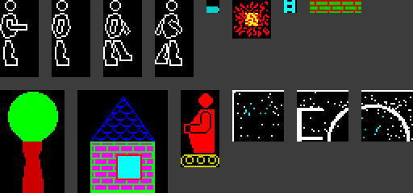

### Музыкальный редактор и мелодии

`EDIT-3` (записи `b_36`–`b_38`: два исходника и код 640 байт с адреса 61000) — редактор
трёхголосых мелодий. Со слов владельца, звук шёл через таймер КР580ВИ53 (три канала
меандра), тактовая частота таймера — предположительно 2 МГц. Сама процедура проигрывания
(адрес 64510), драйвер мыши (64000) и вывод нот спрайтами (64406), на которые ссылается
редактор, на кассете не сохранились, поэтому таблицы частот и темпа нет.

Управление в редакторе:

| Клавиши | Действие |
|---|---|
| CAPS, Z, X, C, V, B, N, M | ноты до, ре, ми, фа, соль, ля, си, до следующей октавы |
| A, S, D, F, G, H, J, K, L | те же ноты с диезом (ряд над «белыми клавишами») |
| ENTER | пауза |
| 1–4 | октава |
| 7, 8, 9 | канал |
| 5, 0 | шаг назад |
| P, O | шаг вперёд с проигрыванием |
| 6 | выход |

Мелодия лежит с адреса 40000, до 999 шагов по 3 байта (по байту на канал). Длительностей
нет: нота звучит столько шагов, сколько раз подряд повторяется.

| Бит байта ноты | Значение |
|---|---|
| 0–2 | нота: 0–7 = до, ре, ми, фа, соль, ля, си, до' |
| 3–4 | октава 0–3 |
| 6 | пауза |
| 7 | диез |

Файл мелодии — `CODE 39997,3000`: байт #FF, два байта числа шагов, затем шаги. Формат
проверен по нотам: `STAIRWAY` даёт арпеджио вступления «Stairway to Heaven» с нисходящим
басом A–G#–G–F#–F, `FEELINGS` — арпеджио ми-минора с басом E–D#–D–C#.

Две мелодии (`LET IT BE`, `I WANT TO`) записаны в более раннем одноголосом формате
(`CODE 60000,2000`): байт #EE, затем по байту на шаг — полутоны от «до» первой октавы со
знаком, как в `BEEP`; #40 — пауза, #29 — пусто.

Все восемь мелодий сконвертированы в `green_svema/tunes/` скриптом `tune2wav.py`:

| Файл | Запись | Голосов | Шагов |
|---|---|---|---|
| `stairway` | `b_42` `STAIRWAY` | 3 | 256 |
| `feelings` | `b_41` `FEELINGS` | 3 | 440 |
| `bad_boys` | `b_44` `BAD BOYS` | 3 | 256 |
| `freedom` | `b_43` `FREEDOM` | 3 | 312 |
| `cancona` | `b_40` `CANCONA` | 3 | 132 |
| `eto_vse` | `b_39` `\|to ws[` («ЭТО ВСЁ» в КОИ-7) | 3 | 414 |
| `let_it_be` | `b_34` `LET IT BE` | 1 | 1259 |
| `i_want_to` | `b_33` `I WANT TO` | 1 | 1415 |

MIDI-файлы лежат в репозитории, WAV — нет (они большие и пересоздаются скриптом). Ноты в
них точные, а два параметра выбраны на глаз, потому что проигрывателя нет: длина шага
(0,2 с) и абсолютная высота трёхголосых мелодий (октава 0 начинается с до большой
октавы). Оба меняются ключами `--step` и `--base`.

### Ранние версии печати и Монитора

Мелкие записи первой стороны складываются в историю того, как появились E.G.-BASIC,
HAINTMON и эмулятор РК.

**Печать** — одна и та же процедура проходит через всю кассету:

| Запись | Файл | Что нового |
|---|---|---|
| 1 | `Print text`, `Print code` | печать строки с позиции в точках плюс выбор сообщения по номеру из таблицы; судя по демонстрационной строке «EXAMPLE OF TEXT TABLE», пример из учебника |
| 7, 8 | `PRINT N.FO` | добавлен цвет на каждую линию символа: после байта точек байт атрибута пишется на 6144 байта дальше. Параметры берутся из ячеек 28671–28676 |
| 10 | `mode8/64` | та же печать и две процедуры переключения режима экрана (см. ниже) |
| сторона 2, `b_50` | без имени | вариант с включением второго экрана через макросы |
| сторона 2, `b_01`–`b_27` | [E.G.-BASIC](#eg-basic), `FN A` | параметры через `DEF FN`, экран с адреса #0000 |

Во всех версиях сохраняется одна и та же ошибка на переходе между третями экрана
(`LD A,D : ADD A,8 : LD A,D`) — она пришла ещё из первой.

**`mode8/64`** — первый подход к цвету 8×1, ещё без теневого ОЗУ. Режим включается
записью 1 в порт экрана (`OUT (0),A`): точки остаются с адреса #4000, а атрибуты
занимают #5800–#6FFF, то есть ложатся поверх системных переменных и программы BASIC.
Поэтому перед включением процедура запрещает прерывания и копирует 1320 байт с адреса
23552 в буфер, а при выходе возвращает их и вызывает очистку экрана из ПЗУ. Всё, что
лежит в #6128–#6FFF, при этом не сохраняется. Название, видимо, означает цвет на 8 или
на 64 точки. Позже то же самое сделано на экране с адреса #0000, где атрибуты ничему не
мешают.

**`MONITRT` / `MONITR`** (записи 5, 6) — предшественник [HAINTMON](#haintmon):
подпрограмма, которую надо вызывать в цикле. Клавиша C включает её, V выключает; в левом
верхнем углу печатаются адрес, байт и символ — в десятичном виде, через процедуры ПЗУ.
Клавиши 1 и 2 двигают адрес, 3 и 4 меняют байт, 5 и CAPS SHIFT переключают скорость.
В HAINTMON та же идея сделана заново: шестнадцатеричный вывод и вызов из прерывания.

**Печать эмулятора РК** (записи 36–38, 39, 49):

| Запись | Файл | Что нового |
|---|---|---|
| 36 | `PRINTTES2` | тестовая версия с адреса 50000, символ берётся из ячейки 23296 |
| 37 | `PRINTCOK-1` | перенесена на рабочий адрес 58060, в конце переход в печать Монитора; исправлено условие в цикле деления (`JR NZ` → `JR NC`) |
| 38 | `PRINTOK-2` | снова тестовая сборка; перевод строки в последней строке экрана больше не уводит курсор наверх |
| 39, 49 | `PRINTOKCO`, `PRINTOKCO2` | собранный код; вторая версия заканчивается переходом в печать Монитора |

**Монитор РК** набирался вручную и по частям — это видно по размерам файлов:

| Запись | Файл | Состояние |
|---|---|---|
| 29 | `MONI.NAT1` | первые 1003 байта |
| 30 | `MONI.NAT2` | первые 1712 байт; отличается от предыдущего только в 11 байтах на стыке |
| 31 | `MONIOK-1` | все 2048 байт. Системные адреса уже перенесены с #76xx на #36xx |
| 32 | `MONIOK-2` | в 11 местах обращения к порту #8002 заменены на вызовы своих процедур |
| 35 | `RADIOMON3` | в 8 из этих мест исправлен адрес вызова (чтение и запись были перепутаны) |
| 48 | `RADIOMON4` | восемь входов таблицы переходов направлены на свои процедуры |

**Шрифты:**

| Запись | Файл | Что это |
|---|---|---|
| 4 | `Russian!` | полный русский шрифт 8×8 с заглавными и строчными, того же рисунка, что `T.N.R.ZNG` |
| 33 | `RadioFont1` | шрифт РК шириной 4 точки: псевдографика, цифры, латиница — первые 96 знаков |
| 34 | `RadioFile2`, `RadioFont!` | другая редакция того же и полный вариант на 128 знаков с кириллицей |

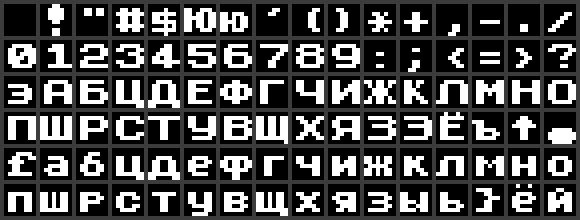

**Запись 28** без заголовка — 2048 байт, которые байт в байт совпадают с адресами
#03D4–#0BD3 стандартного ПЗУ 48K: звук и процедуры работы с лентой. Отсюда, видимо, и
взяты копии `SA-BYTES` и `LD-BYTES` в первом поколении эмулятора РК.

### `VOICER`

Запись `b_51`: редактор гитарных табулатур, целиком на BASIC, звук через `BEEP`.
Сохранён без переменных, так что записанных табулатур в файле нет.

- Данные — массив `A(3000,2)`: до 3000 шагов, два голоса. Нота хранится одним числом
  «струна + лад/100», например 3.07 — третья струна, седьмой лад.
- Строй задан массивом `K` из `DATA 13,8,4,-1,-6,-11` — высота открытых струн для `BEEP`.
  Интервалы между струнами правильные для стандартного строя (5, 4, 5, 5, 5 полутонов),
  а числа на 9 полутонов больше, чем нужно для настоящих нот. Это связано с частотой
  процессора: `BEEP` рассчитан на 3,5 МГц, и на «Балтике» с его 4 МГц всё звучит выше
  на 12·log₂(4/3,5) ≈ 2,3 полутона. Вместе с этим сдвиг получается около 11,3 полутона
  — почти ровно октава над гитарой, то есть строй, видимо, подбирался на слух на своей
  машине. На обычном Спектруме те же числа дадут звук на 9 полутонов выше гитары.
- Подпрограммы вызываются по именам: `LET PRINTER=9015`, затем `GO SUB PRINTER`.
- Редактор (пункт `2.WRITE`): шесть строк-«струн», на экране 8 шагов. Клавиши 8/9 —
  струна, 6/7 — лад (0–20), 0 — записать ноту, V — выбор голоса, B/F — шаг назад и
  вперёд, E — выход.

| Где | Что не так |
|---|---|
| меню | пункт `1.EDIT` ни на что не назначен |
| вставка (клавиша I) | подпрограмма начинается со `STOP`; сам сдвиг написан по возрастанию и размножил бы одну ноту на весь хвост массива |
| проигрывание | высота кладётся в переменную `NOTE` — ту же, где редактор держит текущую позицию; после `3.PLAY` позиция испорчена |
| проигрывание | два голоса не звучат вместе: это два `BEEP` по 0,01 с подряд |
| проигрывание | останавливается на первом шаге, где у первого голоса нет ноты, — паузу в первом голосе сделать нельзя |
| вывод на экран | у первого голоса лад печатается через `(A2 AND ((A1-1)>0))` — на первой струне всегда показывается 0 |
| распаковка ноты | `(A3-INT A3)*100` в арифметике с плавающей точкой даёт не ровно лад, а, например, 6.9999999 |

### HAINTMON

Крошечный резидентный монитор памяти (записи `b_30`, `b_31`): сидит в теневом ОЗУ под ПЗУ
и опрашивается из кадрового прерывания, поэтому вызывается поверх любой работающей
программы. Комментированный листинг — `green_svema/side_2/svema_b_31/HAINTMON.asm`.

| Часть | Что делает |
|---|---|
| `Haintmonc$` (39 байт, адрес 55000) | копирует ПЗУ в теневое ОЗУ через буфер в #8000 и перезапускает машину из ОЗУ |
| `HAINTMON` (1170 байт, адрес #386E) | образ области #386E–#3CFF; сам монитор — 212 байт, #3A00–#3AD3 |
| загрузчик на BASIC | грузит образ и включает `IM 2` с `I`=#39 |

Обработчик сначала вызывает штатное прерывание ПЗУ (`CALL #0038`), потом проверяет
клавиши. По SYMBOL SHIFT + SPACE открывается монитор: в левом верхнем углу строка
`AAAA,DD` — адрес и байт в hex.

| Клавиша | Действие |
|---|---|
| 1 / 2 | уменьшить / увеличить байт |
| 3 / 4 | предыдущий / следующий адрес |
| Q / W | медленный / быстрый автоповтор |
| E | перейти по текущему адресу |
| 5 | закрыть |

Не сходится одно: таблица векторов `IM 2` (#3900–#39FF) в образе заполнена нулями, то есть
прерывание уходило бы на #0000, а не на монитор. Либо адрес 0 в копии ПЗУ правился
отдельно, либо на ленте незаконченная версия.

`Haintmonc$` переключает теневое ОЗУ командой `OUT (0),A`, а не через порт #7E. Так же
делает и процедура турбо в [ПЗУ «Балтика»](#пзу-балтика).

### Программатор ПЗУ `PROG+`

Записи `b_46` (код 465 байт с адреса 32000) и `b_47` (оболочка на BASIC). Авторство под
вопросом: владелец писал программатор сам, но его устройство управлялось целиком через
ВВ55, а порта #EF он не помнит — возможно, это чужая программа под другую плату.
Исходника на кассете нет, а между процедурами оставлены промежутки из `NOP` до «круглых»
адресов, чего в программах владельца, собранных ассемблером, не встречается. Микросхемы 2716, 2764, 27128, 27256; в меню чтение, запись, проверка на
чистоту и сверка, но реально доделаны только чтение и запись. Разбор по чтению кода.

Подключение:

| Порт | Назначение |
|---|---|
| 31 (ВВ55, порт A) | данные ПЗУ |
| 63 (порт B) | старший байт адреса |
| 95 (порт C) | младший байт адреса |
| 127 | управляющее слово ВВ55: #90 — чтение (порт A на ввод), #80 — запись |
| 239 (#EF) | отдельный регистр управляющих сигналов, 4 бита |

Биты порта 239, восстановленные по последовательностям для трёх типов микросхем:

| Бит | Сигнал |
|---|---|
| 0 | `/CE` (у 2716 — совмещённый `CE/PGM`) |
| 1 | `/OE` |
| 2 | `/PGM` (2764 и 27128) |
| 3 | 1 — на `Vpp` обычные 5 В, 0 — программирующее напряжение |

| Микросхема | Покой | Чтение | Запись: подготовка → импульс |
|---|---|---|---|
| 2716 | 1010 | 1000 | 0010 → 0011 |
| 2764, 27128 | 1111 | 1100 | 0110 → 0010 |
| 27256 | 1001 | 1000 | 0000 → 0010 |

Тип микросхемы BASIC задаёт, вписывая эти значения `POKE`-ами прямо в операнды команд.

Алгоритм записи байта: импульс около 1,2 мс (при 4 МГц), затем чтение и сравнение; до 50
попыток. Когда байт прочитался верно — ещё один «закрепляющий» импульс втрое длиннее.
Если за 50 попыток не получилось, выход в BASIC с адресами и данными; продолжение со
следующего байта — отдельной точкой входа. Ход работы показывается записью байтов адреса
и счётчика попыток прямо в экранную память.

Недоделки и ошибки:

| Где | Что |
|---|---|
| BASIC, пункты Test и Verify | переходы на строки 2000 и 2500, которых нет. Сами процедуры в коде есть, но команда сравнения в них оставлена пустой (`NOP`) и должна вписываться `POKE`-ом из этих строк, как `LD (HL),A` для чтения |
| BASIC, строка 7050 | `LET y=y-…` вместо `u` — третья цифра адреса считается неверно |
| BASIC, строка 7520 | `d(1)` вместо `s(1)` |
| BASIC, строки 7000–7100 | нет `RETURN`, подпрограмма проваливается в следующую |
| BASIC, строки 1570–1580 | проверяется `g$`, которой ничего не присваивается |

#### `Programato` (сторона 1, запись 11)

Не отдельная программа, а тот же машинный код `PROG+`, перенесённый с адреса 32000 в
строку `REM` (адрес 23760) и настроенный под 27256; BASIC-оболочки нет, строка `REM` —
единственная в программе, после кода в ней около 1,8 КБ символов «0» про запас.

Перенос сделан правкой адресов вручную, и в трёх местах с ошибками:

| Место | Что не так |
|---|---|
| закрепляющий импульс | удлинённая задержка пишется в 23810 вместо 23814 — то есть портится не счётчик задержки, а значение, которое уходит в порт #EF на время импульса (2 → 255), и обратно оно не восстанавливается |
| признак «запись закончена» | пишется в 24224 вместо 24223 |
| сброс того же признака | остался старый адрес 32463 |

В этой копии сравнение в процедуре сверки вписано (`CP (HL)`), так что сверка здесь
рабочая. Параметры зашиты прямо в код и показывают, для чего её использовали:

| Процедура | Что делает с этими параметрами |
|---|---|
| чтение | первые 6913 байт ПЗУ — в экранную память, с адреса 16384 |
| сверка | 16 КБ ПЗУ сравниваются с памятью начиная с адреса 0 |
| запись | в ПЗУ пишутся 16 КБ памяти начиная с адреса 0 |

То есть прошивалось содержимое адресов #0000–#3FFF машины, на которой это запускали, —
её ПЗУ или его копия из теневого ОЗУ. Чья это была машина и плата, см. оговорку об
авторстве в начале раздела. В сохранённом состоянии остались адреса последних остановок: сверка —
на адресе 4, запись — на адресе 209.

### `READ-HEAD`

Записи 2 и 3 стороны 1: программа, которая читает заголовок с ленты и печатает тип, имя,
длину, адрес загрузки или строку автозапуска. Набрана из польского издания: имена
переменных `pocz`, `adr`, сообщения «Długość samego programu», «Autostart - linii»,
«Adres ładowania», «Tablica», для польских букв определены свои символы UDG.

Загрузчик на BASIC хранит код в строках `DATA` шестнадцатеричными цифрами с контрольной
суммой в конце каждой строки. Блок кода с записи 2 (286 байт с адреса 60000) совпадает с
тем, что получается из этих `DATA`. Сам код перемещаемый: базовый адрес берётся из `BC`,
как его оставляет `USR`.

## Файлы и инструменты

### Что лежит в директориях

| Файл | Что это |
|---|---|
| `blocks.txt` | список блоков ленты с пометками OK / DAMAGED |
| `*.bin` | содержимое файла с ленты без флага и контрольной суммы |
| `*.bas.txt` | листинг BASIC |
| `*.src.txt` | ассемблерный исходник с ленты (в файле: 2 байта номера строки, текст, CR) |
| `*.skool` | дизассемблированный код (SkoolKit), без комментариев |
| `*.asm` | листинг с комментариями (`PATCH.EXE`, `PATCH2.EXE`, `PCOUTOK.EX`, `NEW4RA.EXE`, `HAINTMON`) |
| `*.png` | экраны, листы спрайтов, шрифты |
| `NN_headerless.bin` | блок без заголовка, как есть |

В корне, рядом с образами:

| Файл | Что это |
|---|---|
| `wav2tap.py` | декодер WAV → TAP для изношенных лент (нужен numpy), [описание](#декодер-wav2tappy) |
| `tapextract.py` | распаковка TAP в директорию: `.bin`, листинги BASIC, исходники, PNG, дизассемблирование (если найден `sna2skool.py` из SkoolKit) |
| `tune2wav.py` | конвертер мелодий редактора `EDIT-3` в WAV и MIDI |
| `*.tap` | результат `wav2tap.py` для лент, у которых есть WAV |
| `Makefile`, `readme_ids.py` | `make` собирает `README.html` и `index.html` из этого файла через `cmark-gfm`; скрипт добавляет заголовкам якоря для ссылок |
| `.github/workflows/pages.yml` | сборка и публикация сайта на GitHub Pages при каждом push |
| `LICENSE` | лицензия на скрипты, см. [Лицензия](#лицензия) |
| `piton_zx/` | «Питон» с записи 26 `green_svema`, перенесённый на Спектрум: исходник для sjasmplus, `Makefile`, готовый TAP, скриншоты; [описание](#питон-для-спектрума-запись-26) |
| `rk86_plus3/` | эмулятор «Радио-86РК» с записи 27 `green_svema`, пересобранный для +2A/+3: исходник для sjasmplus, `Makefile`, готовые TAP (эмулятор, «Питон» для РК, BASIC для РК), конвертер файлов РК `rkr2tap.py`, [инструкция](rk86_plus3/README.md), скриншоты; [описание](#пересборка-первого-поколения-для-2a3) |
| `tnr_48k/` | «Три недели в раю» для запуска в эмуляторе: TAP (обычный и для +2A/+3), скрипт сборки и подмены шрифта в ПЗУ, скриншоты |

В директориях лент 25, 26 и 30 первой кассеты файлы названы без номера блока и без `blocks.txt` —
они разобраны раньше остальных.

### Декодер `wav2tap.py`

```
./wav2tap.py tape.wav            # список блоков и tape.tap
./wav2tap.py tape.wav -x DIR     # ещё и тела блоков в DIR
./wav2tap.py -n *.wav            # только список блоков
./wav2tap.py -s 2 tape.wav       # принудительно удвоенная скорость
```

На этих лентах нули (высокая частота) записаны намного слабее единиц и «плавают» на
низкочастотной волне, не пересекая ноль, — обычные конвертеры на этом теряют
синхронизацию. Декодер сначала убирает низкочастотную составляющую (вычитает скользящее
среднее), затем ищет переходы через ноль с порогом относительно местного уровня сигнала.

Скорость записи определяется автоматически: пробуются обычная и удвоенная («турбо»),
берётся вариант, где сошлось больше контрольных сумм.

Кроме того, декодер переживает три вида помех, встретившихся на `green_svema`:

- сбой внутри пилот-тона — не принимается за синхроимпульс, если за ним снова идёт пилот;
- блок без паузы после предыдущего — пилот следующего блока не читается как данные;
- щелчок (импульс короче любого настоящего) — приклеивается к соседним импульсам.

Проверка: на лентах 01, 03 и 22 результат совпал с прочитанным из TZX байт в байт. Во
всех 115 WAV (12 с первой кассеты и 103 с `green_svema`) все блоки сошлись по
контрольной сумме.

## Лицензия

- **Скрипты** (`wav2tap.py`, `tapextract.py`, `tune2wav.py`, `readme_ids.py`,
  `tnr_48k/build.py`, `IMC/draw_schematic.py`, `Makefile`) — лицензия MIT, текст в файле
  `LICENSE`.
- **Описание, перерисованная схема и остальные картинки, сделанные при разборе**, —
  [Creative Commons Attribution 4.0](https://creativecommons.org/licenses/by/4.0/deed.ru).
- **Содержимое кассет под эти лицензии не подпадает.** Образы лент и извлечённые из них
  файлы выложены как архив. Среди них есть чужие работы: игра Three Weeks in Paradise
  (Mikro-Gen, 1986; свободно распространяется на World of Spectrum), Монитор
  «Радио-86РК», ORDOS для «Ориона-128», программа `READ-HEAD` из польского издания,
  фрагменты ПЗУ ZX Spectrum. Права на них принадлежат их авторам.

