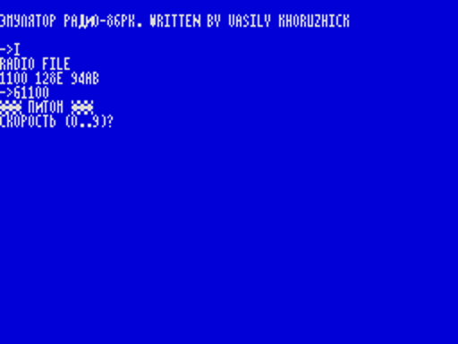
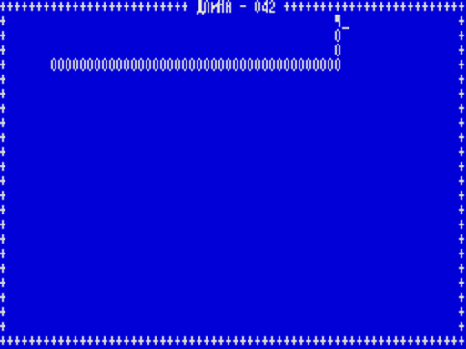
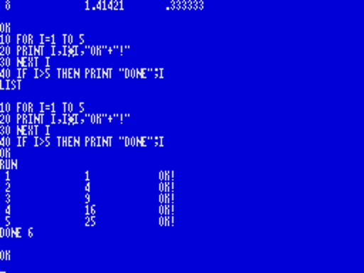
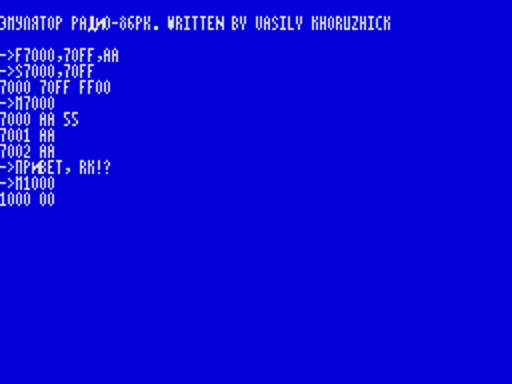
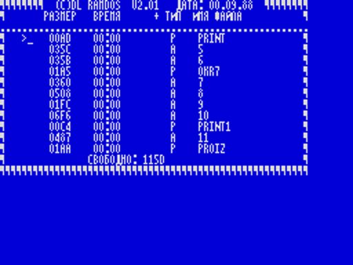

# Эмулятор «Радио-86РК» для ZX Spectrum +2A/+3

Пересборка программы «Radio-interface» с кассеты `green_svema` (сторона 1, запись 27).
Это не эмулятор процессора: код РК (8080) исполняется на Z80 как есть, подменено
окружение — память с нуля, Монитор по адресам #F800…, экран 64 знака в строке и лента.
Эмулируется РК с 32 КБ: программа живёт в #0000–#75FF, видеопамять — на своём обычном
месте, #76D0–#7FF3.

| Лента | Что на ней |
|---|---|
| `rk86.tap` | эмулятор: загрузчик на BASIC и блок кода |
| `piton.tap` | игра «Питон» для РК-86 — запись 26 той же кассеты |
| `basic.tap` | BASIC для РК-86 — `BASIC80.RKR` с [rk86.ru](https://rk86.ru/files/BASIC80.RKR) |
| `rdisk1.tap`, `rdisk2.tap` | RAMDOS V2.01 вместе с диском в памяти — `RDISK1.PKI` и `RDISK2.PKI` [оттуда же](https://rk86.ru/files/RDISK1.PKI) |

Все ленты, кроме первой, читает уже Монитор эмулятора, директивой `I`.







## Запуск

Нужен +2A, +2B или +3 (или эмулятор в одном из этих режимов): используется режим «всё
ОЗУ» порта #1FFD. На 48K, 128K и сером +2 программа работать не будет.

1. Загрузить `rk86.tap` из +3 BASIC (`LOAD "t:": LOAD ""`) или пунктом Loader. Из
   48 BASIC нельзя: там порты страниц заблокированы.
2. Появится строка `ЭМУЛЯТОР РАДИО-86РК. WRITTEN BY VASILY KHORUZHICK` и приглашение `->`.
3. Вставить ленту с программой, набрать `I` и ENTER, пустить ленту. Монитор напечатает
   имя файла `RADIO FILE` и три числа: начало, конец, контрольная сумма.
4. Запустить программу директивой `G`.

| Лента | После `I` | Запуск |
|---|---|---|
| `piton.tap` | `1100 128E 94AB` | `G1100` |
| `basic.tap` | `0000 19FF 5B6B` | `G0` |
| `rdisk1.tap` | `3600 6471 4800` | `G3600` |
| `rdisk2.tap` | `3600 6C9C CC0F` | `G3600` |

**«Питон».** На вопрос `СКОРОСТЬ (0..9)?` нажать цифру (0 — медленно, 9 — очень быстро;
скорости совпадают с настоящим РК), на `НАЖМИТЕ <ВК>` — ENTER. Управление: `Q` — вверх,
`A` — вниз, `O` — влево, `P` — вправо.

**BASIC.** Работает как на РК; загрузки и записи программ на ленту (`CLOAD`, `CSAVE`) нет —
см. ниже про побайтный обмен с лентой.

**RAMDOS.** Лента — образ памяти: сама система и за ней диск с файлами. Команды —
буквами из строки `КОМАНДА [D,E,S,T,N,M,B]`: `D` — каталог, `E` и `T` — список файлов с
указателем, `M` — выход в Монитор. Правок не понадобилось. Система рассчитана на 25 строк,
поэтому верхняя линия рамки уходит за край экрана.

Выход в Монитор из любой программы — CAPS+ENTER; память при этом сохраняется, и программу
можно запустить снова той же директивой `G`.

## Директивы Монитора

Числа шестнадцатеричные, параметры разделяются запятыми, пробелы не учитываются.
Директива исполняется по ENTER; точка в любом месте строки отменяет ввод. Ответ `?` —
ошибка в строке.

| Директива | Что делает |
|---|---|
| `G<адрес>` | запуск программы; `RET` из программы возвращает в Монитор |
| `M<адрес>` | просмотр и изменение памяти: печатает адрес и байт; новый байт и ENTER — записать, просто ENTER — оставить; точка — выход |
| `F<начало>,<конец>,<байт>` | заполнить область байтом, конец включительно |
| `I` или `I<смещение>` | загрузить файл с ленты по адресу из заголовка плюс смещение; печатает имя, начало, конец и контрольную сумму. SPACE прерывает загрузку |
| `O<начало>,<конец>` | записать область на ленту; печатает начало, конец и контрольную сумму |
| `S<начало>,<конец>` | контрольная сумма области, считается как в Мониторе РК |
| `L<a>,<b>,<c>,<x>,<y>,<z>` | заменить в памяти #0000–#75FF каждую тройку байт `a b c` на `x y z` |

Файлы на ленте — в формате Спектрума: заголовок типа `CODE` с именем `RADIO FILE` и блок
данных. Контрольная сумма при записи кладётся во второй параметр заголовка. Файлы в
родном формате РК с ленты не читаются; файл `.rkr` превращает в такую ленту
`rkr2tap.py` (см. [ниже](#свои-программы)).

## Клавиатура

| Клавиши | Что дают |
|---|---|
| буквы, цифры, SPACE, ENTER | они же; ENTER — <ВК> (#0D) |
| CAPS+5, 6, 7, 8 | стрелки ← ↓ ↑ → (#08, #1A, #19, #18) |
| CAPS+0 | <ЗБ> (#7F), в строке Монитора — забой |
| CAPS+1, 2, 3, 4, 9 | <АР2> (#1B), <ТАБ> (#09), курсор в начало (#0C), <СТР> — очистка экрана (#1F), <ПС> (#0A) |
| CAPS+буква | управляющий код, как <УС> на РК: буква минус #40 (CAPS+C — #03, прерывание программы в BASIC) |
| CAPS+SPACE | тоже #03 |
| SYM+клавиша | знак, как на клавишах Спектрума: `! @ # $ % & ' ( ) _ < > ; " : ? / = + - ^ , . *`; кроме того `[` `]` — SYM+Y, SYM+U и `\` — SYM+D |
| CAPS+SYM | <РУС/ЛАТ>. В режиме РУС буквы и знаки `@ [ \ ] ^` дают коды #60–#7E — русские буквы; мигает левый верхний угол экрана |
| CAPS+ENTER | выход в Монитор из любой программы; память программы сохраняется, экран очищается |
| SYM+A | выключить перерисовку экрана: программе достаётся почти весь процессор, но экран замирает |
| SYM+B | включить перерисовку обратно (заодно вводит `*`) |

Нажатие, принятое вводом с ожиданием, подтверждается щелчком; у клавиш есть автоповтор
(полсекунды, потом 16 раз в секунду).

## Что доступно программам РК

Точки входа Монитора:

| Адрес | Что делает |
|---|---|
| #F800 | холодный старт: экран очищается, память программы не трогается |
| #F803 | ввод знака с клавиатуры с ожиданием, код в A |
| #F809, #F80F | вывод знака из C |
| #F812 | A = #FF, если есть непрочитанное нажатие, иначе 0 |
| #F815 | вывод A двумя шестнадцатеричными цифрами |
| #F818 | вывод строки по адресу HL до нулевого байта |
| #F81B | код нажатой сейчас клавиши; #FF — ничего, #FE — <РУС/ЛАТ> |
| #F81E | положение курсора: H = строка + 3, L = столбец + 8 |
| #F821 | знак под курсором в A |
| #F824 | загрузка с ленты: HL = смещение; на выходе HL = начало, DE = конец, BC = сумма из заголовка |
| #F827 | запись на ленту: HL = начало, DE = конец, BC = сумма |
| #F82A | контрольная сумма блока HL…DE в BC |
| #F830, #F833 | прочитать и установить границу свободной памяти (сначала #75FF) |
| #F86C | тёплый старт: приглашение Монитора без очистки экрана |
| #F806, #F80C, #F82D | пустые: побайтного обмена с лентой и ВГ75 здесь нет |

Нажатие клавиши — событие, как в Мониторе РК: `#F812` сообщает о нём, `#F803` забирает.
Клавиша, уже прочитанная через `#F803`, для `#F812` снова «нажата» только когда сработает
автоповтор.

Вывод знака понимает коды #07 (звонок), #08, #18, #19, #1A (курсор), #0A, #0D, #0C, #1F
и `ESC Y <строка + #20> <столбец + #20>` — как Монитор РК, включая прокрутку.

Экран — окно 64×24 в видеопамяти РК: знак в строке `r` и столбце `c` лежит по адресу
#77C2 + 78·r + c, как на настоящем РК. Программа может писать туда напрямую, изменения
появляются на экране в следующем кадре. У РК строк 25; двадцать пятая здесь не видна.

Чего нет:

- портов клавиатуры и ВВ55 (#8000–#8003, #A000–#A003), ВГ75 и ВТ57 — запись по этим
  адресам ничего не делает (запись в #C000–#C001 попадает в два первых байта экрана
  Спектрума, их прерывание каждый кадр рисует заново);
- побайтного обмена с лентой (#F806, #F80C), а значит, и `CLOAD`/`CSAVE` в BASIC;
- звука через `EI`/`DI` — на Спектруме эти команды просто управляют прерыванием. Все
  вызовы Монитора, работающие с экраном и клавиатурой, на выходе разрешают прерывания:
  без них экран не обновляется;
- двадцать пятой строки экрана.

## Свои программы

```
./rkr2tap.py ПРОГРАММА.RKR лента.tap [АДРЕС=БАЙТЫ ...]
```

Скрипт делает из файла РК (`.rkr`, `.rk`, `.gam`: адреса начала и конца, данные,
контрольная сумма) ленту для директивы `I` и печатает контрольную сумму, которую покажет
Монитор. Необязательные параметры `АДРЕС=БАЙТЫ` (шестнадцатеричные) правят программу
перед записью.

Многое идёт как есть — так собраны ленты RAMDOS. Править приходится то, что на Z80
работает иначе, чем на 8080, или рассчитано на другой экран; «Питон» и BASIC — примеры:

**«Питон»** (`piton.asm`) — запись 26 кассеты с тремя правками:

- строк 24, а не 25: нижняя рамка, длина боковых стенок, место старта и надпись
  «НАЖМИТЕ <ВК>» подняты на строку (пять мест);
- файл на кассете собран под РК с 16 КБ: четыре адреса видеопамяти #37xx–#3Fxx
  перенесены в #77xx–#7Fxx;
- управление: коды стрелок в четырёх сравнениях заменены на `O`, `P`, `Q`, `A`.

**BASIC** (`Makefile`) — 6 байт в двух местах и 16 байт подпрограмм в нулях в самом конце
интерпретатора. Причина — флаг чётности: у 8080 он после арифметики показывает чётность
результата, у Z80 — переполнение. Сравнение чисел в BASIC от Microsoft возвращает #FF, 0
или 1, а вызывающий код проверяет результат командами `JPO`/`JPE`; на Z80 печать любого
числа зацикливается. То же самое в Altair BASIC разобрано в
[журнале проекта Isetta](https://hackaday.io/project/190345/log/219462-another-interesting-basic-to-test-the-8080-instructions),
о том же предупреждает
[документация SIMH AltairZ80](https://www.bitsavers.pdp-11.ru/1401/simh_v2.9-10/AltairZ80/altairZ80.txt)
(«will not or not properly run on a Z80. This is mainly due to the use of the parity flag
on the 8080»).

| Адрес | Было | Стало |
|---|---|---|
| #12D0 | `SBB A : RNZ : INR A : RET` | `JP #19EE` |
| #19EE | нули | `SBC A,A : JR Z,+3 : SRA A : RET : INC A : RET` — те же A и перенос, а `SRA` даёт для #FF чётность, как на 8080 |
| #096E | `ADC A : RPE : MVI E,#18 : JMP #02D8` | `JP #19F6` |
| #19F6 | нули | `ADC A,A : OR A : RET PE : LD E,#18 : JP #02D8` — проверка типа; `OR A` превращает флаг в чётность |

## Сборка

```
make        # rk86.tap, piton.tap, basic.tap
```

Нужны sjasmplus и python3. Шрифт и «Питон» берутся из `../green_svema/side_1/svema_27`
и `svema_26`, BASIC и RAMDOS — из `BASIC80.RKR`, `RDISK1.PKI` и `RDISK2.PKI` в этой
директории.

Проверено в симуляторе (ядро Z80 из SkoolKit с моделью страниц +3 и подачей ленты на
вход EAR): загрузка обеих лент, директивы Монитора, прокрутка, запись на ленту с обратным
декодированием, две минуты игры в «Питона» с едой, ростом, гибелью и новыми партиями, в
BASIC — арифметика, строки, `FOR`, `IF`, `LIST`, `RUN`, сообщения об ошибках, в RAMDOS — запуск с обоих дисков, каталог, списки `E` и `T`, выход
в Монитор. Целиком, вместе с
загрузчиком на BASIC, запущено в эмуляторе Xpeccy. На настоящей машине не запускалось.
